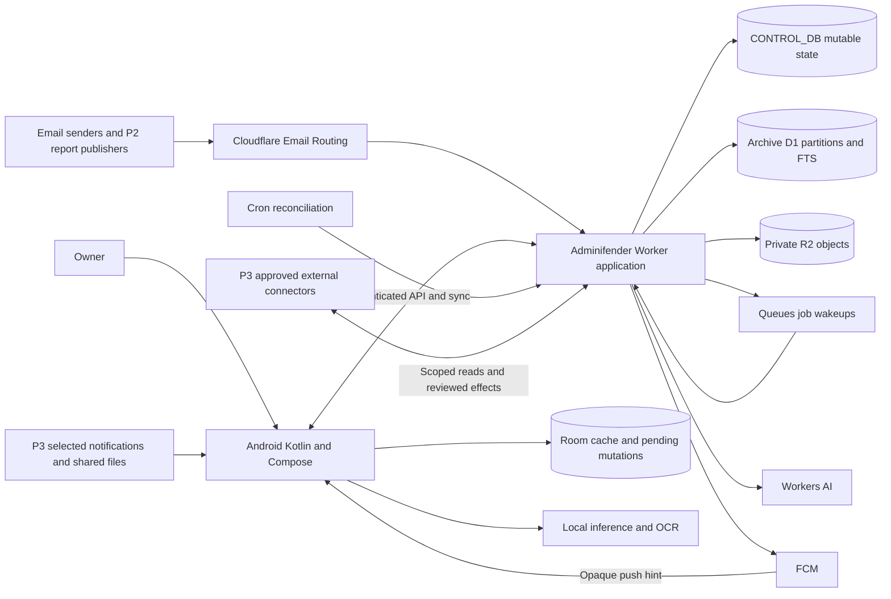
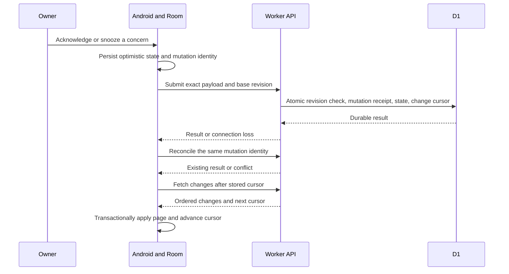

# HLD — High-Level Design

Version 1.0 · October 1, 2026 · **Selected design; no application or infrastructure is implemented by this document.**

The [SRS](srs.md) owns requirements and acceptance criteria. The [baseline](baseline.md) owns shared policy defaults, the [SDD](sdd.md) describes subsystem behavior, and the [LLD](lld.md) owns concrete schemas and wire contracts. [TDD](tdd.md) contains dated platform evidence, release gates, and capacity estimates.

## 1. Architectural intent

Adminifender is a single-owner attention and operations system: retain evidence, identify concerns worth review, and help the owner act with a reliable record of the outcome. Its Android client and backend remain independent of Whumpo customer identity and its planned Android app. Email is the only external ingestion channel in P1 and P2. P3 capabilities are designed here but cannot be enabled before their connector gates pass.

The design uses one TypeScript Cloudflare Worker application, deployed independently per environment. Its HTTP, email, Queue-consumer, and scheduled entry points delegate to ordinary modules. A control D1 database owns mutable authoritative state; bounded archive D1 partitions own immutable source revisions, extracted text, and full-text indexes. Private R2 owns attachment, large normalized-text, staging, and export bytes. Queues accelerate durable work, while D1 jobs and an outbox preserve work identity and recovery. An Android Room database supports offline reads and pending local operations. The architecture deliberately does not require an always-running phone for archival, deterministic critical rules, or notification scheduling.

These choices are recorded in [ADR-0001](adr/0001-personal-boundaries.md), [ADR-0002](adr/0002-storage-and-retention.md), and [ADR-0003](adr/0003-jobs-and-recovery.md).

## 2. System context and deployment

The diagram is a target topology, not evidence that its resources exist. Local development uses synthetic content and service adapters; staging and production have separate Worker identities, control/archive D1 databases, R2 buckets, queues, secrets, and push registrations. A production phone is not registered to a staging notification audience. Deployment origin, ingest domain, signing fingerprints, and provider account IDs are configuration inputs verified before activation.

The Android application provides Inbox, Archive, Chat, Operations, and Settings/Diagnostics destinations. Operations appears in P2; P3 controls appear only when enabled and healthy. The phone holds device credentials and a content cache, never Cloudflare operator tokens. FCM is the selected push transport because the target S24+ has Google Play services; push delivery remains a best-effort prompt to fetch authoritative state.

## 3. Trust and authority boundaries

| Boundary | Allowed flow | Enforcement |
| --- | --- | --- |
| Internet email → ingest | Untrusted source bytes and transport metadata | Explicit blocks precede archive; bounded parsing; provider authentication observations and application report signatures are recorded separately. |
| Phone → backend | Owner reads, routine inbox edits, proposals, reviewed operations | Passkey-backed sessions, device revocation, request validation, mutation identity, and current revision checks. |
| Backend → object storage | Private source and derived objects | Authorized record lookup precedes content streaming; R2 keys never confer authorization. |
| Evidence → model | Bounded allowed text chunks | Privacy policy, quarantine/deletion checks, provenance labels, and schema-constrained responses. Evidence cannot instruct the application to execute tools. |
| Model → action engine | Typed proposal with cited evidence | Application validation and explicit review; no model-generated code, arbitrary HTTP target, or hidden side effect. |
| Adminifender → Whumpo/provider | P2 evidence or P3 scoped adapter request | Separate credentials and resource allowlists; reported success does not authorize an operation. |

Local-only inference restricts where interpretation runs; Cloudflare still receives and stores the email under the accepted archive design. This is not end-to-end encrypted cloud storage. Sensitive Whumpo customer statements must never enter the report producer payload, general AI corpus, push payload, or operational logs. A locally downloaded copy remains accessible offline until the device next learns of revocation/deletion; server access is immediately revocable, but remote deletion from an offline phone is not promised.

Identity and action authority follow [ADR-0004](adr/0004-identity-and-actions.md). Inference privacy follows [ADR-0005](adr/0005-hybrid-inference.md).

## 4. Primary data flows

### Durable email before interpretation

1. Inspect the envelope and bounded headers for explicit address/domain blocks. A manually blocked delivery is rejected and produces only content-free aggregate diagnostics. It is not archived.
2. Persist accepted raw MIME to private R2 staging with an application receipt identity. Commit the corresponding D1 source/capture state and outbox job. An object without a completed D1 receipt is repairable through staging reconciliation.
3. Parse and normalize complete text and attachment inventory. Verify object byte counts and hashes before marking the capture complete. An automatic spam suspicion marks the source quarantined; normalization is allowed, but OCR, generative inference, embeddings, and concern generation wait for owner release.
4. Write the immutable source revision and text index in its assigned archive partition, verify their hash, then atomically publish its ready pointer with job/outbox and sync changes in CONTROL_DB. Delivering an outbox job to Queues is a separate repeatable action. Queue loss, duplication, or delay cannot be the only record of pending work.
5. Apply deterministic rules and permitted inference, then update concern membership, explanation, and importance. Evaluate notification policy from that committed state.

There is no transaction covering R2, an archive partition, and CONTROL_DB. Immutable object identities, capture states, hashes, and reconciliation make partial outcomes visible and repairable; they do not create an exactly-once external delivery guarantee. Provider rejection before the Worker is outside the application's capture boundary. Failed captures remain available for repair until explicitly deleted.

### Offline review and synchronization

A server change and its monotonically increasing cursor are committed in the same D1 transaction. A device commits a received change page and its cursor in one Room transaction. Neither side advances a cursor before applying its associated data. Tombstone expiry forces a fresh bootstrap for stale devices. Routine edits can be queued offline; external effects require online review of current resources and are never replayed merely because connectivity returns. See [ADR-0006](adr/0006-android-and-sync.md).

### Interpretation and source-grounded chat

The routing module evaluates policy before reserving work or selecting a model. Explicit privacy exclusions and no-AI policies take precedence over availability or cost. No-AI also disables OCR; deterministic text parsing remains permitted. Both inference adapters accept the same bounded input contract and return validated application data. A durable task has one current fenced attempt; expired or duplicate device/cloud results cannot silently replace a newer accepted result.

Chat retrieval starts with authorized, nondeleted, nonquarantined source chunks and selected scope. Generated answers carry citations to source revisions and text spans; unsupported claims are labeled as inference or lack of evidence. Conversation turns survive app/background interruptions. Chat can propose an action, but only the action engine can obtain a review and dispatch an operation. Search, archive access, and ordinary inbox review do not depend on AI availability. See [ADR-0008](adr/0008-search-and-extraction.md).

## 5. P2 and P3 integration topology

P2 Whumpo report publishers execute outside Adminifender and email bounded, sanitized JSON report attachments through the existing ingest route. The signed wrapper authenticates application provenance; it does not make email text trusted instructions. Recognized report envelopes/dedicated report aliases remain no-AI until validation; rejected or protected-field payloads stay quarantined restricted owner evidence rather than entering ordinary cloud triage. Report records store service, kind, event identity, sequence, event time, receipt time, and source evidence. Maintenance, releases, operator decisions, usage, service dependencies, readiness reminders, and heartbeat observations feed the same concern and timeline systems. All displayed operational state is explicitly **last reported** until a later read obtains current evidence.

P3 adds separate approved adapter kinds behind the same source and operation interfaces:

- **Direct service reads:** bounded Cloudflare/Whumpo polling obtains current resource snapshots and stores observation time, resource revision, and request receipt. Polls stop on revoked authority or quota limits.
- **Signed webhooks and GitHub synchronization:** validate subscriptions/signatures, deduplicate deliveries, then reconcile provider state through a scoped read before presenting a current result. Event ordering is tracked per resource; arrival order is not treated as truth.
- **Android notifications and share/file intake:** explicit owner-selected sources produce synthetic source records with their origin and grant provenance; they use the same archive/privacy/extraction pipeline. They cannot silently expand a grant to every installed app.
- **Outbound email and service actions:** drafts become immutable reviewed operations. Dedicated adapters accept only supported typed actions against allowlisted targets; each persists provider receipts and offers authoritative readback for uncertainty. No generic shell or arbitrary URL tool is exposed.
- **Semantic retrieval and forecasting:** derived indexes and estimates augment retained evidence. Retrieval rechecks D1 deletion/privacy state; suggested learned rules require acceptance before changing routing or notification behavior.

The connector lifecycle, P2 report schema, and P3 action protocol are specified in [SDD](sdd.md), [LLD](lld.md), and [ADR-0009](adr/0009-phased-integrations.md). Existing Whumpo artifacts are references, not an available Adminifender integration API.

## 6. Failure containment and operational model

| Failure | Preserved capability and recovery |
| --- | --- |
| AI unavailable, local device offline, or allowance exhausted | Raw/normalized archive, explicit rules, text search, routine review, and rule-based critical alerts continue; pending interpretation is visible. |
| Queue send fails after database commit | Scheduled reconciliation republishes the durable outbox; duplicate delivery is harmless to a replay-safe handler. |
| R2 object succeeds but D1 commit fails | Staging reconciliation imports or surfaces an orphan receipt; cleanup never deletes an unverified failed capture. |
| Parsing/extraction fails | Original content is retained, state identifies the failed stage, and retry is bounded. Quarantine still blocks expensive stages. |
| Phone is offline or process dies | Room retains the review queue and request identities; reconciliation recovers acknowledged results. |
| External request response is lost | Operation is uncertain; provider readback or owner inspection establishes the outcome before any new reviewed attempt. |
| Push is denied or delayed | The authoritative inbox remains correct; diagnostics distinguish provider acceptance from device display and owner review. |
| Archive approaches configured service limits | Capacity diagnostics surface the condition, processing is throttled, and the owner can export/delete or approve capacity; archived evidence is not silently discarded. |

Archive partitions warn and roll over at the baseline capacity thresholds; provisioning/binding a new partition requires a reviewed deployment. Without a writable partition, accepted MIME remains staged with a visible pending-index state. A source registry routes reads; cross-partition search is bounded and resumable. Content-free diagnostics distinguish receipt, capture, parsing, extraction, inference, synchronization, and push stages. Cost counters separate known provider usage, estimates, reservations, and invoice observations. Jobs and action receipts are operational state rather than transient logs. Deletion first appends suppression intent to an independent private R2 ledger with a signed current head; only then does the control mutation commit. Backup/restore requires that current verified suppression history before reopening access, discards all restored authentication/push registrations, and requires fresh independent enrollment. Missing current deletion evidence blocks restored reads. [ADR-0010](adr/0010-cost-and-observability.md) and the TDD define the operational controls.

## 7. Acceptance boundary

The [SRS traceability matrix](srs.md) connects this architecture to every functional/nonfunctional requirement and acceptance group. Architecture acceptance requires fault-injection evidence for cross-service handoffs and offline synchronization, actual S24+ inference/notification checks, and staged credential/recovery tests. Documentation of a provider capability does not establish account entitlement, correct configuration, or device performance. The architecture is accepted as the implementation target; activation remains gated by those verifications.
