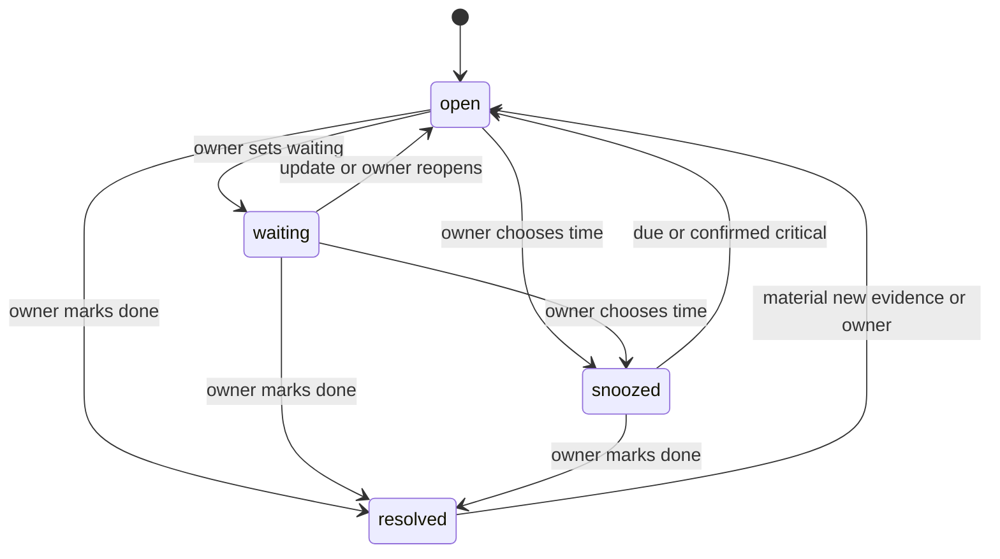

# Low level design

Version 1.0 — October 1, 2026. Status: selected implementation contracts, not application code or deployed APIs. [SRS](srs.md) is normative; [baseline](baseline.md) owns shared limits/defaults. Names below are proposed Adminifender interfaces, never claims about existing Whumpo endpoints.

## Contract conventions

Use UTF-8 JSON and HTTPS. API prefix `/api/v1`; random UUIDv4 entity/request IDs; UTC RFC3339 timestamps on the wire and integer Unix milliseconds in SQL; monetary estimates integer USD micro-units plus currency/source; no floating money. Paths contain opaque IDs, never R2 keys. Every authenticated query is bound to the sole enrolled owner and a nonrevoked device/session.

Responses use `{data, requestId}`; lists add `{nextCursor, snapshot}`. Errors use `{error:{code,message,retryable,details},requestId}` without secrets/upstream bodies. Cursor content is server-HMAC-protected, bound to owner, query/filter digest, snapshot, partition positions and expiry (24 hours). Default/max page sizes are 50/200. Reject unknown mutation fields and enum values using shared versioned JSON Schemas; tolerate unknown optional response fields in Android. Enforce 256 KiB ordinary JSON bodies; uploads use the separate bounded streaming contract.

All non-auth mutations require `Idempotency-Key: UUID`; same key+method+path+canonical request hash returns retained result, mismatched content returns `409 idempotency_conflict`. Expected entity revision is a required JSON field for updates. Return `409 stale_revision` with the current revision, not silent last-write-wins. Use a new key for changed intent. An expired key is not a safe way to retry an uncertain external effect: its permanent operation ID is authoritative.

Status codes: 400 malformed/invalid fields; 401 unauthenticated/expired; 403 revoked/forbidden/feature disabled; 404 missing or inaccessible; 409 stale/reused identity; 410 deleted/expired cursor or review; 413 bounded-size exceeded; 422 unsupported content or unmet precondition; 429 quota/rate-limited with Retry-After; 503 provider/unavailable. `202` always means durable pending work, never completion.

<a id="storage"></a>
## Persistent data model

Use CONTROL_DB for mutable state and a binding-allowlisted archive partition for immutable source bytes/metadata/chunks. The control registry maps source UUID to partition. A partition row's `binding_name` must resolve through a compiled deployment manifest, never dynamic arbitrary binding access or a model-provided name. P1 begins with ARCHIVE_0001. See TDD for reviewed partition rollover; a source never changes partitions without a recorded copy/hash/readback operation.

The following SQL is a schema contract. Runtime migrations will be generated as numbered reviewed files during implementation. JSON columns use SQLite TEXT with JSON validation at the API boundary. Foreign keys are within one database only; all cross-database references are checked by the domain service. `*_json` contents have the versioned types defined below. Index every cleanup `state,next_at` query and every source/concern relationship.

### Control database schema

```sql
PRAGMA foreign_keys=ON;
CREATE TABLE owner(id TEXT PRIMARY KEY CHECK(id='owner'), created_at INTEGER NOT NULL, auth_epoch INTEGER NOT NULL DEFAULT 1);
CREATE TABLE passkeys(id TEXT PRIMARY KEY, owner_id TEXT NOT NULL REFERENCES owner(id), public_key BLOB NOT NULL, sign_count INTEGER NOT NULL, transports_json TEXT NOT NULL, backup_eligible INTEGER NOT NULL, backed_up INTEGER NOT NULL, created_at INTEGER NOT NULL, revoked_at INTEGER);
CREATE TABLE devices(id TEXT PRIMARY KEY, owner_id TEXT NOT NULL REFERENCES owner(id), name TEXT NOT NULL, revision INTEGER NOT NULL DEFAULT 1, capabilities_json TEXT NOT NULL, fcm_token_cipher BLOB, last_seen INTEGER, revoked_at INTEGER);
CREATE TABLE auth_challenges(id TEXT PRIMARY KEY, kind TEXT NOT NULL CHECK(kind IN ('bootstrap','register','authenticate','recent','recover')), challenge_digest TEXT NOT NULL UNIQUE, device_id TEXT, context_json TEXT NOT NULL, expires_at INTEGER NOT NULL, consumed_at INTEGER);
CREATE TABLE sessions(id TEXT PRIMARY KEY, device_id TEXT NOT NULL REFERENCES devices(id), auth_epoch INTEGER NOT NULL, family_id TEXT NOT NULL, refresh_digest TEXT NOT NULL UNIQUE, access_digest TEXT NOT NULL UNIQUE, created_at INTEGER NOT NULL, access_expires INTEGER NOT NULL, refresh_expires INTEGER NOT NULL, recent_auth_at INTEGER, consumed_at INTEGER, revoked_at INTEGER);
CREATE TABLE recovery_keys(id TEXT PRIMARY KEY, secret_digest TEXT NOT NULL UNIQUE, created_at INTEGER NOT NULL, used_at INTEGER);
CREATE TABLE settings(id TEXT PRIMARY KEY CHECK(id='owner'), revision INTEGER NOT NULL, values_json TEXT NOT NULL, updated_at INTEGER NOT NULL);
CREATE TABLE archive_partitions(id INTEGER PRIMARY KEY, binding_name TEXT NOT NULL UNIQUE, state TEXT NOT NULL CHECK(state IN ('writable','sealed','maintenance')), created_at INTEGER NOT NULL, sealed_at INTEGER);
CREATE UNIQUE INDEX one_writable_partition ON archive_partitions(state) WHERE state='writable';
CREATE TABLE source_registry(id TEXT PRIMARY KEY, kind TEXT NOT NULL, external_key TEXT NOT NULL, content_hash TEXT NOT NULL, partition_id INTEGER REFERENCES archive_partitions(id), admission TEXT NOT NULL CHECK(admission IN ('normal','quarantine')), privacy TEXT NOT NULL CHECK(privacy IN ('hybrid','local_only','no_ai','restricted_metadata')), state TEXT NOT NULL CHECK(state IN ('staged','pending_index','ready','parse_failed','deleting','deleted')), revision INTEGER NOT NULL, staged_key TEXT, received_at INTEGER NOT NULL, ready_seq INTEGER, privacy_floor TEXT NOT NULL DEFAULT 'hybrid', deleted_at INTEGER, UNIQUE(kind,external_key));
CREATE INDEX source_state_age ON source_registry(state,received_at);
CREATE TABLE block_rules(id TEXT PRIMARY KEY, revision INTEGER NOT NULL, kind TEXT NOT NULL CHECK(kind IN ('address','domain')), match_field TEXT NOT NULL CHECK(match_field IN ('envelope_from','header_from','either')), normalized_value TEXT NOT NULL, enabled INTEGER NOT NULL, created_at INTEGER NOT NULL, UNIQUE(kind,match_field,normalized_value));
CREATE TABLE rules(id TEXT PRIMARY KEY, revision INTEGER NOT NULL, origin TEXT NOT NULL CHECK(origin IN ('owner','learned')), enabled INTEGER NOT NULL, predicate_json TEXT NOT NULL, effect_json TEXT NOT NULL, created_at INTEGER NOT NULL);
CREATE TABLE concerns(id TEXT PRIMARY KEY, revision INTEGER NOT NULL, title TEXT NOT NULL, status TEXT NOT NULL CHECK(status IN ('open','waiting','snoozed','resolved')), importance TEXT NOT NULL CHECK(importance IN ('routine','important','urgent','critical')), critical_basis TEXT, critical_signal_id TEXT, material_digest TEXT, due_revision INTEGER NOT NULL DEFAULT 0, waiting_note TEXT, follow_up_at INTEGER, read_at INTEGER, acknowledged_at INTEGER, resolved_at INTEGER, snooze_until INTEGER, due_at INTEGER, due_zone TEXT, due_source_text TEXT, service_id TEXT, updated_at INTEGER NOT NULL);
CREATE TABLE concern_sources(concern_id TEXT NOT NULL REFERENCES concerns(id), source_id TEXT NOT NULL REFERENCES source_registry(id), PRIMARY KEY(concern_id,source_id));
CREATE TABLE concern_events(id TEXT PRIMARY KEY, concern_id TEXT NOT NULL REFERENCES concerns(id), from_revision INTEGER NOT NULL, to_revision INTEGER NOT NULL, kind TEXT NOT NULL, before_json TEXT NOT NULL, after_json TEXT NOT NULL, created_at INTEGER NOT NULL);
CREATE TABLE attachment_processing(attachment_id TEXT PRIMARY KEY, source_id TEXT NOT NULL REFERENCES source_registry(id), revision INTEGER NOT NULL, state TEXT NOT NULL CHECK(state IN ('stored','queued','extracting','ready','unsupported','failed','deferred')), detail TEXT, active_generation TEXT, policy_revision INTEGER NOT NULL, job_id TEXT);
CREATE TABLE review_state(id TEXT PRIMARY KEY CHECK(id='owner'), last_meaningful_at INTEGER, last_reviewed_seq INTEGER NOT NULL DEFAULT 0, review_epoch TEXT NOT NULL);
CREATE TABLE briefings(id TEXT PRIMARY KEY, snapshot_seq INTEGER NOT NULL, through_time INTEGER NOT NULL, included_revisions_json TEXT NOT NULL, summary_json TEXT, created_at INTEGER NOT NULL, reviewed_at INTEGER);
CREATE TABLE spam_overrides(id TEXT PRIMARY KEY, revision INTEGER NOT NULL, kind TEXT NOT NULL CHECK(kind IN ('address','domain')), normalized_value TEXT NOT NULL, verdict TEXT NOT NULL CHECK(verdict IN ('quarantine','trust')), enabled INTEGER NOT NULL, UNIQUE(kind,normalized_value));
CREATE TABLE triage_results(id TEXT PRIMARY KEY, source_id TEXT NOT NULL REFERENCES source_registry(id), source_revision INTEGER NOT NULL, policy_revision INTEGER NOT NULL, provenance_json TEXT NOT NULL, result_json TEXT NOT NULL, created_at INTEGER NOT NULL);
CREATE TABLE changes(seq INTEGER PRIMARY KEY AUTOINCREMENT, entity_type TEXT NOT NULL, entity_id TEXT NOT NULL, revision INTEGER NOT NULL, deleted INTEGER NOT NULL, projection_json TEXT NOT NULL, created_at INTEGER NOT NULL);
CREATE INDEX changes_age ON changes(created_at);
CREATE TABLE mutations(key TEXT PRIMARY KEY, request_hash TEXT NOT NULL, state TEXT NOT NULL CHECK(state IN ('pending','complete')), result_json TEXT, created_at INTEGER NOT NULL, expires_at INTEGER NOT NULL);
CREATE TABLE jobs(id TEXT PRIMARY KEY, dedupe_key TEXT NOT NULL UNIQUE, kind TEXT NOT NULL, source_id TEXT, input_revision INTEGER, state TEXT NOT NULL CHECK(state IN ('pending','leased','running','complete','failed','dead','cancelled','uncertain')), attempt INTEGER NOT NULL DEFAULT 0, lease_token TEXT, lease_until INTEGER, next_at INTEGER NOT NULL, input_json TEXT NOT NULL, output_json TEXT, error_code TEXT, created_at INTEGER NOT NULL);
CREATE INDEX jobs_due ON jobs(state,next_at);
CREATE TABLE outbox(id TEXT PRIMARY KEY, dedupe_key TEXT NOT NULL UNIQUE, kind TEXT NOT NULL, reference_id TEXT NOT NULL, state TEXT NOT NULL CHECK(state IN ('pending','sending','sent','failed')), next_at INTEGER NOT NULL, attempts INTEGER NOT NULL DEFAULT 0);
CREATE TABLE chat_threads(id TEXT PRIMARY KEY, scope_json TEXT NOT NULL, created_at INTEGER NOT NULL);
CREATE TABLE chat_turns(id TEXT PRIMARY KEY, thread_id TEXT NOT NULL REFERENCES chat_threads(id), request_hash TEXT NOT NULL, content TEXT NOT NULL, state TEXT NOT NULL CHECK(state IN ('pending','running','complete','failed','uncertain','cancelled')), answer TEXT, citations_json TEXT, created_at INTEGER NOT NULL);
CREATE TABLE inference_attempts(id TEXT PRIMARY KEY, job_id TEXT NOT NULL REFERENCES jobs(id), route TEXT NOT NULL CHECK(route IN ('local','cloud')), model_id TEXT NOT NULL, policy_revision INTEGER NOT NULL, input_digest TEXT NOT NULL, state TEXT NOT NULL, reservation_json TEXT NOT NULL, usage_json TEXT, dispatched_at INTEGER, completed_at INTEGER);
CREATE TABLE budget_periods(id TEXT PRIMARY KEY, starts_at INTEGER NOT NULL, ends_at INTEGER NOT NULL, limit_json TEXT NOT NULL, reserved_json TEXT NOT NULL, settled_json TEXT NOT NULL, observed_headroom_json TEXT, observed_at INTEGER);
CREATE TABLE action_reviews(id TEXT PRIMARY KEY, kind TEXT NOT NULL, params_json TEXT NOT NULL, digest TEXT NOT NULL, preconditions_json TEXT NOT NULL, expires_at INTEGER NOT NULL, consumed_operation_id TEXT UNIQUE, created_at INTEGER NOT NULL);
CREATE TABLE operations(id TEXT PRIMARY KEY, review_id TEXT NOT NULL UNIQUE REFERENCES action_reviews(id), state TEXT NOT NULL CHECK(state IN ('prepared','dispatching','succeeded','failed','uncertain','cancelled')), dispatch_token TEXT, intent_json TEXT NOT NULL, receipt_json TEXT, error_code TEXT, created_at INTEGER NOT NULL, dispatched_at INTEGER, settled_at INTEGER);
CREATE TABLE notification_events(id TEXT PRIMARY KEY, dedupe_key TEXT NOT NULL UNIQUE, concern_id TEXT, concern_revision INTEGER, kind TEXT NOT NULL, state TEXT NOT NULL CHECK(state IN ('pending','sent','failed','uncertain','suppressed')), not_before INTEGER NOT NULL, expires_at INTEGER NOT NULL, created_at INTEGER NOT NULL);
CREATE TABLE notification_deliveries(event_id TEXT NOT NULL REFERENCES notification_events(id), device_id TEXT NOT NULL REFERENCES devices(id), state TEXT NOT NULL, provider_receipt TEXT, sent_at INTEGER, PRIMARY KEY(event_id,device_id));
CREATE TABLE service_catalog(id TEXT PRIMARY KEY, revision INTEGER NOT NULL, name TEXT NOT NULL, aliases_json TEXT NOT NULL, targets_json TEXT NOT NULL, created_at INTEGER NOT NULL);
CREATE TABLE service_dependencies(parent_id TEXT NOT NULL REFERENCES service_catalog(id), child_id TEXT NOT NULL REFERENCES service_catalog(id), relation TEXT NOT NULL, PRIMARY KEY(parent_id,child_id,relation), CHECK(parent_id<>child_id));
CREATE TABLE connectors(id TEXT PRIMARY KEY, revision INTEGER NOT NULL, kind TEXT NOT NULL, enabled INTEGER NOT NULL DEFAULT 0, config_json TEXT NOT NULL, secret_ref TEXT, cursor_json TEXT, last_success INTEGER, error_code TEXT);
CREATE TABLE report_keys(id TEXT PRIMARY KEY, service_id TEXT NOT NULL REFERENCES service_catalog(id), secret_ref TEXT NOT NULL, revoked_at INTEGER);
CREATE TABLE reports(service_id TEXT NOT NULL, event_id TEXT NOT NULL, sequence INTEGER NOT NULL, source_id TEXT NOT NULL REFERENCES source_registry(id), kind TEXT NOT NULL, occurred_at INTEGER NOT NULL, payload_json TEXT NOT NULL, verified_at INTEGER NOT NULL, PRIMARY KEY(service_id,event_id));
CREATE TABLE heartbeat_expectations(service_id TEXT PRIMARY KEY, revision INTEGER NOT NULL, interval_ms INTEGER NOT NULL, grace_ms INTEGER NOT NULL, last_sequence INTEGER, last_received INTEGER, concern_id TEXT);
CREATE TABLE cost_entries(id TEXT PRIMARY KEY, revision INTEGER NOT NULL, service_id TEXT, source_id TEXT NOT NULL REFERENCES source_registry(id), period_start INTEGER, period_end INTEGER, currency TEXT NOT NULL, amount_micros INTEGER NOT NULL, evidence_kind TEXT NOT NULL, owner_confirmed_at INTEGER);
CREATE TABLE runbooks(id TEXT PRIMARY KEY, revision INTEGER NOT NULL, service_id TEXT, title TEXT NOT NULL, steps_json TEXT NOT NULL, evidence_json TEXT NOT NULL, owner_reviewed_at INTEGER);
CREATE TABLE learned_candidates(id TEXT PRIMARY KEY, state TEXT NOT NULL, predicate_json TEXT NOT NULL, effect_json TEXT NOT NULL, evaluation_json TEXT NOT NULL, approved_rule_id TEXT REFERENCES rules(id));
CREATE TABLE forecasts(id TEXT PRIMARY KEY, service_id TEXT, period_json TEXT NOT NULL, method TEXT NOT NULL, input_ids_json TEXT NOT NULL, result_json TEXT NOT NULL, created_at INTEGER NOT NULL);
CREATE TABLE exports(id TEXT PRIMARY KEY, snapshot_seq INTEGER NOT NULL, state TEXT NOT NULL, manifest_key TEXT, object_key TEXT, created_at INTEGER NOT NULL, expires_at INTEGER NOT NULL);
CREATE TABLE deletion_ledger(id TEXT PRIMARY KEY, source_id TEXT NOT NULL, deleted_at INTEGER NOT NULL, state TEXT NOT NULL, targets_json TEXT NOT NULL, completed_at INTEGER);
CREATE TABLE audit_events(id TEXT PRIMARY KEY, kind TEXT NOT NULL, entity_id TEXT, outcome TEXT NOT NULL, metadata_json TEXT NOT NULL, created_at INTEGER NOT NULL);
```

Auth epoch invalidates all sessions after recovery. Session rotation stores the consumed refresh digest until family expiry so reuse can revoke the family. Device FCM tokens are encrypted with a backend key; opaque app access/refresh secrets are stored hashed. Privacy floor values are hybrid/no_ai/restricted_metadata; protected-report no-AI floor cannot be lowered by release or ordinary privacy edits. Provider/report secrets use Workers secrets or authenticated encryption under a versioned Worker secret, never plaintext model context or database logs.

### Archive partition schema

```sql
PRAGMA foreign_keys=ON;
CREATE TABLE sources(id TEXT PRIMARY KEY, kind TEXT NOT NULL, received_at INTEGER NOT NULL, subject TEXT NOT NULL, envelope_json TEXT NOT NULL, headers_json TEXT NOT NULL, normalized_text TEXT, text_object_key TEXT, text_hash TEXT NOT NULL, provenance_json TEXT NOT NULL, parser_version TEXT NOT NULL, CHECK(normalized_text IS NOT NULL OR text_object_key IS NOT NULL));
CREATE TABLE attachments(id TEXT PRIMARY KEY, source_id TEXT NOT NULL REFERENCES sources(id), name TEXT NOT NULL, declared_type TEXT, detected_type TEXT, size_bytes INTEGER NOT NULL, sha256 TEXT NOT NULL, object_key TEXT NOT NULL, disposition TEXT NOT NULL, UNIQUE(source_id,id));
CREATE TABLE chunks(id TEXT PRIMARY KEY, source_id TEXT NOT NULL REFERENCES sources(id), attachment_id TEXT REFERENCES attachments(id), generation_id TEXT NOT NULL, ordinal INTEGER NOT NULL, page INTEGER, start_offset INTEGER, text TEXT NOT NULL, text_hash TEXT NOT NULL, method TEXT NOT NULL, UNIQUE(source_id,attachment_id,generation_id,ordinal));
CREATE VIRTUAL TABLE source_fts USING fts5(source_id UNINDEXED, chunk_id UNINDEXED, generation_id UNINDEXED, subject, body, filename, tokenize='unicode61');
CREATE TABLE archive_receipts(source_id TEXT PRIMARY KEY, staging_hash TEXT NOT NULL, manifest_hash TEXT NOT NULL, committed_at INTEGER NOT NULL);
```

D1 rows are bounded well below the provider limit: maximum 256 KiB text per source row; chunks maximum 6,000 characters; header/provenance JSON each 64 KiB. Use an explicit unique chunk ID derived from source/attachment/generation/ordinal because nullable UNIQUE fields do not deduplicate source-level chunks. FTS rows and chunks for a generation insert in one archive batch. Initial body generation is body-v1; attachment extraction generations are jobId+fencingToken. CONTROL attachment_processing owns active generation/state, never archive attachment rows. Readers include only the active published generation; late stale archive writes stay invisible and are garbage-collected. Search/deletion always consult current CONTROL_DB authority, admission/privacy and tombstone state before returning data, including after a source is deleted while the archive index lags.

R2 prefixes: `staging/{sourceId}/{sha256}.eml`, `attachments/{sourceId}/{attachmentId}/{sha256}`, `text/{sourceId}/{sha256}.txt`, `exports/{exportId}/...`, `backups/{date}/...`. Do not deduplicate attachment objects across different sources initially; per-source paths make explicit deletion reliable. Same-source retries reuse the exact content hash. Backups are encrypted before being stored in a separate private bucket; the recovery key is held outside the phone and backend account.

<a id="identity"></a>
## Identity and owner enrollment

An operator bootstrap command, implemented later, installs a random 256-bit, 15-minute, single-use bootstrap credential hash. Its plaintext is shown once through private operator output. Public registration stays disabled. The owner opens the configured HTTPS enrollment origin with that credential, registers a passkey, verifies it, and receives a 256-bit one-time recovery secret for offline storage. No password or email magic-link fallback.

Credential Manager uses the same RP ID as the owner HTTPS domain. Production Digital Asset Links contain only the actual package and Play app-signing certificate. The backend verifies challenges, expected RP/origin (HTTPS enrollment origin or the exact Android android:apk-key-hash origin derived from the production Play distribution certificate), user verification, signature, credential authority and replay state using a maintained WebAuthn verification library; it never implements signature parsing ad hoc. Support backup-eligible passkey counters without treating nonincrementing synchronized counters alone as proof of compromise. Challenges expire after 5 minutes and are single-use.

| Method and path | Request and result |
| --- | --- |
| POST `/auth/bootstrap/options` | `{bootstrapToken,deviceName}` → challenge/options; rate-limit before expensive verification. |
| POST `/auth/bootstrap/verify` | `{challengeId,credential}` → enrolled owner/device and one-time recovery material; options and verify consume one bootstrap transaction. |
| POST `/auth/passkey/options` | `{deviceId?,purpose:sign_in|recent}` → assertion challenge; does not disclose credential inventory to unauthenticated callers. |
| POST `/auth/passkey/verify` | `{challengeId,assertion,deviceCapabilities}` → opaque access/refresh tokens and expiry; recent purpose upgrades only the initiating session. |
| POST `/auth/refresh` | Refresh token supplied in dedicated Authorization scheme → rotated access/refresh pair; old-token replay revokes its family. |
| POST `/auth/recovery/options` | `{recoverySecret,newDeviceName}` → restricted registration challenge only, never archive access. |
| POST `/auth/recovery/verify` | `{challengeId,credential}` → atomically consume key, replace compromised passkeys, increment auth epoch, revoke all sessions, install replacement and show rotated recovery secret once. |
| GET `/devices` | Authenticated device list with token status, no tokens. |
| POST `/devices/{id}/revoke` | `{expectedRevision,reviewId}` → revoked device and pending-local-work cancellation signal. |
| POST `/auth/logout` | Revoke this session family; app clears local keys/cache and cancels workers. |

Recovery verification is a single control transaction; a lost success response requires ordinary sign-in with the newly registered passkey, followed by a recent-auth recovery-key rotation. It cannot replay a consumed recovery secret to expose the archive. Recovery attempt limits are 5 per device/IP per hour; successful authenticated rotation resets no unrelated limits. Keep a second enrolled passkey on another authenticator as an available recovery aid, not mandatory two-passkey signup.

<a id="ingestion"></a>
## Email admission and capture

1. Validate metadata bounds and apply explicit blocks using parsed envelope/header addresses. Domain values are lowercase IDNA ASCII exact domains, not wildcard suffix matches; address rules preserve the local part exactly and normalize the domain. `either` matches either parsed address; malformed/multiple From fields never count as trusted. No rule means no manual rejection. Manual block wins over every allow/trust hint.
2. Before reading/storing the body, reject a block match with `setReject` and increment aggregate rule/day counts without a body, subject or address log. Provider rejection outside the handler cannot be archived.
3. For allowed mail, stream raw bytes into a temporary R2 object while hashing, bounded by the provider message ceiling. Derive dedupe external key as SHA-256 of recipient + raw content hash, not Message-ID alone. A duplicate delivered to a distinct recipient remains a distinct source. Claim the unique registry key after object write; delete/reconcile orphan temporary objects. A crash before registry insertion is discoverable through staging inventory metadata containing recipient hash and arrival ID.
4. Commit registry `staged` plus parse job/outbox in one CONTROL_DB batch; then return. Do not claim Cloudflare automatically retries a failed invocation: if staging fails, surface an ingest failure and use the provider's supported error behavior. The failure drill must establish actual sender/provider behavior before activation.
5. Parse bytes with bounded MIME parser; archive text/files and archive receipt. Keep the control source staged/pending_index until steps 6–7 settle admission and its privacy floor. Successful archive receipt exists before any staging deletion. Parsing failures retain raw bytes and `parse_failed` state.
6. Apply cheap spam heuristics using trusted transport authentication metadata when available, not sender-injected copies. Use a versioned score (repeated promotional patterns, malformed headers, known correction rules); score >=3 quarantines. Keywords such as “urgent” alone do not suffice; unauthenticated mail alone is not discarded. No generative model is required for admission. Optional bounded spam model uses the same budget/privacy gate, and can only quarantine. Quarantine may be assigned at capture from metadata and finalized after bounded text normalization.
7. Recognized report envelopes or dedicated operator-report aliases set a protected privacy floor before any model work. Unknown/forbidden sensitive fields or failed signatures remain restricted quarantine; releasing the item never makes the raw protected payload model-eligible. Only a validated sanitized projection may be processed.

The admission detector `spam-rules-v1` scans at most the first 64 KiB of normalized text plus bounded headers/links; archival still retains all text. Implement these exact initial weights, summing independent features: enabled owner quarantine override +100; normalized body hash matching an owner-confirmed spam sample +3; malformed/multiple From +2; three or more distinct phrases from `free money`, `guaranteed income`, `lottery winner`, `claim your prize`, `wire transfer urgently`, `risk free investment` +1; more than five distinct external link domains +1; visible literal domain differing from actual href host +1; both trusted transport SPF and DKIM explicitly failed +1. Unknown authentication is 0. Threshold >=3 quarantines. Enabled trust override bypasses heuristic suspicion only when authenticated aligned sender matches; it never bypasses manual blocks, protected-report policy or file bounds. Store detector version and feature codes, not a calibrated probability. GET/POST/PATCH `/spam-overrides[/{id}]` manages the typed override table; changing a rule does not release existing quarantine automatically. Spam-body fingerprints reference retained owner-confirmed sources and are removed when those sources are deleted.

8. In one CONTROL_DB batch, publish `ready`, selected partition, final admission/privacy, change record and only the jobs permitted by that decision. A failed detector retains a visible processing failure and never publishes model/extraction eligibility. No downstream job can race ahead of admission or protected-report validation. Triage/extraction starts only after the archive is ready and admission normal, with current privacy rechecked. Quarantine release makes the source normal in one control revision and enqueues permitted missing jobs once; it cannot lower the privacy floor. UI offers a separate explicit “trust future mail from this address” correction; it does not remove a manual block implicitly.

| Method and path | Contract |
| --- | --- |
| GET `/sources` | Filters `admission,kind,sender,from,to,serviceId,state`; sanitized metadata and continuation. |
| GET `/sources/{id}` | Full normalized text or paged chunks, attachment metadata, admission/privacy/provenance and readiness. |
| GET `/sources/{id}/chunks` | Ordered bounded chunks with stable citation IDs/page/offset. |
| GET `/attachments/{id}/content` | Authorized private streamed bytes, attachment disposition, sanitized filename and nosniff; never active inline HTML. |
| GET/POST `/block-rules` | List or create `{kind,matchField,value}`; exact effect displayed before creation. |
| PATCH `/block-rules/{id}` | `{expectedRevision,enabled}` or validated new exact match fields. |
| POST `/sources/{id}/quarantine` | `{expectedRevision,reason}` → quiet retained source, invalidated derived jobs; no deletion. |
| POST `/sources/{id}/release` | `{expectedRevision}` → normal admission and missing jobs. |
| PATCH `/sources/{id}/privacy` | `{expectedRevision,privacy}`; cannot lower a protected source privacy floor; stricter privacy cancels pending prohibited jobs and invalidates prohibited derivatives; cannot retract completed provider processing. |
| POST `/sources/{id}/reprocess` | `{expectedRevision,stages:[parse|extract|triage]}` → jobs against current content/policy; no provider-uncertain retry through this route. |

<a id="extraction"></a>
## Text extraction and OCR

Canonical extraction states are stored, queued, extracting, ready, unsupported, failed and deferred; secondary detail is encrypted, limit, device_unavailable, policy_blocked or a fixed parser error. no_ai forbids OCR and generative processing while deterministic text parsing remains allowed; local_only permits device OCR.

Use per-attachment jobs keyed by attachment hash, extractor version and policy revision. Server extractors: UTF-8/text with charset fallback, CSV/JSON/Markdown text, parse5 HTML text with meaningful hrefs, bounded DOCX ZIP/XML text including tables. Reject XML entity expansion and external references; cap expanded DOCX XML/text at 20 MiB/1,000 entries and compression ratio at 100:1. Never execute macros or recursively unpack generic archives.

Device PDF path: text extraction through PdfRenderer on API 35+, OCR only pages without meaningful text; API 31–34 render then OCR. Use bundled ML Kit Latin OCR, no remote OCR upload. Page rendering maximum 4 megapixels at a time; image input resampled to maximum 16 megapixels; original bytes untouched. Process at most 100 pages per job and checkpoint each page; additional pages remain deferred with a Resume next pages action. A server lease hands out an attachment to one device worker; downloaded files live in app-private encrypted cache and are removed on revocation/logout.

Extraction result: `{attachmentId,contentHash,extractorVersion,policyRevision,leaseToken,generationId,batchOrdinal,pages:[{page,text,method,confidence?}],complete,lastPage}`. Submit at most 128 KiB of UTF-8 text and 10 pages per batch within the 256 KiB JSON request; split large page text into numbered parts/chunks and include page/part offsets. A job checkpoint records next batch/page/part. Batch identity generationId+batchOrdinal is immutable; same identity with altered hash conflicts. Final complete batch includes the ordered batch manifest hash before publication. Confidence is optional recognizer evidence, not a universal probability. Validate hash, current policy, active device and fencing token before accepting. Write immutable archive generation chunks first. Only a fenced CONTROL transaction checking current lease, policy and input hash may publish attachment_processing.active_generation and job receipt/change; concurrent late archive writes cannot change that pointer. Reconcile repeated batches by deterministic generation chunk IDs, then garbage-collect unpublished generations after one day. Archive source text is immutable; parse reprocessing repairs missing outputs, and a parser upgrade creates a separately published derivative, never overwrites original evidence. If original MIME has expired and the requested reparse needs it, return original_raw_unavailable. Retrying a failed extraction does not lose the original or create duplicate chunks.

`POST /device-work/claim` accepts supported task kinds/model manifest; returns one bounded job and expiry. `POST /device-work/{id}/heartbeat` renews the current fencing token. `POST /device-work/{id}/result` validates typed output; stale/revoked/deleted results return `409 stale_job` or `410 deleted`. Unavailable devices leave explicit queued work; WorkManager scheduling is not treated as an exact-time service guarantee.

<a id="triage"></a>
## Rules and triage

Predicates are a closed AST: `all`, `any`, `sender_equals`, `domain_equals`, `service_equals`, `subject_contains`, `body_contains`, `report_kind`, `authentication_result`. Maximum depth 4, 20 predicates, 200-character literal. No regex or user code. Rule effects are `surface`, `less_important`, `assign_service`, `suggest_due`, or owner-defined `critical`; no action execution. Priority: privacy/admission first, explicit owner rules before approved learned rules, then model suggestion. More-specific address rule precedes domain rule; remaining ties use ascending persisted creation ID, with critical owner rule winning importance ties. UI shows the winning rule.

Triage output schema: `{summary,category,importance,uncertainty:[string],deadline:{text,instant?,zone?,ambiguous}|null,serviceIds:[id],evidence:[{chunkId,start,end}],suggestedActions:[ActionProposal]}`. Category is `operations|billing|security|personal|support|other`. Every evidence offset must be inside its selected chunk; dates with missing year/timezone stay proposed/ambiguous. Model importance may be `routine|important|urgent`; a textual critical suggestion is translated to urgent awaiting explicit rule/owner confirmation. Invalid output is retained as an error category without rendering raw tool instructions; one schema-repair attempt is a separately reserved inference, then visible failure.

`GET/POST/PATCH /rules[/{id}]` use the closed predicate/effect shapes. `POST /concerns/{id}/corrections` accepts `{expectedRevision,importance,applyTo:this_concern|sender|domain,reason?}` and returns the edited concern plus an optional explicit rule preview. Persist a sender/domain rule only when separately confirmed. Do not implicitly unblock a sender or change source privacy.

<a id="concerns"></a>
## Concern lifecycle and grouping



Read/acknowledged timestamps and importance are independent fields. Group by verified `(serviceId,concernKey)` reports, then verified thread references within the same recipient mailbox, then explicit owner merge. Subject similarity offers a merge proposal only. Receipt dedupe is separate from grouping. Material updates change a canonical digest of condition, importance, due date, requested decision, outcome or normalized meaningful thread body. Sequence, event ID and timestamps alone only establish ordering and never reopen or push. Material updates reopen resolved concerns but preserve ordinary active snoozes; the rule-confirmed critical exception follows the notification policy. Reopened concerns clear acknowledgment only for the new revision, keeping prior history.

GET `/concerns` supports status, importance, service, due-before and updated-since. GET `/concerns/{id}` returns evidence references, revisions, safe controls and last-reported timestamps. POST `/concerns/{id}/actions` accepts `{expectedRevision,kind:acknowledge|resolve|reopen|snooze|wait|set_due|mark_read,args}`. `snooze` requires a future instant; `wait` persists optional waiting note/awaited party and follow_up_at separately from source due_at; `set_due` retains source text/timezone. Apply mutation, concern event, full change projection and meaningful-review timestamp in one control transaction. Merely `mark_read` does not advance meaningful review.

POST `/concerns/{id}/undo` references an event and its exact resulting revision, and is available for 10 minutes after reversible review edits; mismatch conflicts rather than overwriting later work. POST `/concerns/merge` requires all current IDs/revisions and chosen target; POST `/concerns/{id}/split` requires explicit source IDs/revision. Both preserve all source links/history and produce changes for affected entities. Merging does not authorize deletion or service actions.

<a id="briefings"></a>
## Briefings

GET `/briefings/current` uses the persisted meaningful-review cursor and includes new sources, changed concerns, overdue and unacknowledged unresolved items. Deterministic cards are always available; optional inference summarizes only allowed evidence. Store `{snapshotSeq,throughTime,includedConcernRevisions,summary?,citations}` so displayed content can be marked reviewed without acknowledging unseen later changes. POST `/briefings/{id}/review` advances review timestamp/cursor through that snapshot only; no automatic resolution. Clock is backend UTC; configured IANA zone affects presentation/quiet hours.

<a id="inference"></a>
## Hybrid inference and execution contracts

Routing order is deterministic: no-AI returns `not_allowed`; quarantine/deletion blocks; local-only waits for local; otherwise choose a ready foreground local session for interactive tasks, or an already claimed ready device for background jobs; else choose cloud if budget/headroom allows; else queue for local and expose the reason. Background work does not wake a phone merely to claim a token-cost saving. Battery/thermal/charging gates use baseline values and OS capability reports, never model claims.

Local tokenizer and context limit come from a signed/pinned model manifest `{modelId,artifactUrl,sha256,byteLength,licenseUrl,runtimeVersion,contextTokens,inputLimit,outputLimit,tokenizerDigest}`. Download only after owner opt-in on unmetered network by default; verify SHA-256 before loading. CPU is required baseline; GPU is enabled only after a reproducible acceptance measurement on the actual device. No dependency on Galaxy AI/Gemini Nano eligibility.

Long documents split into stable source chunks then token-sized inference pieces. Local 2,048-context model receives <=1,536 input tokens including instructions and <=256 output; cloud limits are in baseline. Keep a separately bounded rolling conversation summary plus retrieved chunks; never stuff complete archive/history into a prompt. Character limits do not substitute for token limits. Same validated application schema applies across adapters.

Budget reservation uses a control transaction with guarded counters for the relevant UTC day/month, estimated maximum tokens, current model rate/neurons and remaining included allocation. Unknown/stale account headroom, missing model rate or uncoordinated other account writers denies cloud under the default zero-paid setting. Included-only dispatch requires a dedicated account or all account writers participating in conservative reservations; a fresh but racy provider snapshot alone is insufficient. Expired undispatched reservations release; dispatched uncertain attempts keep reserved exposure until known result or explicitly recorded reconciliation. Do not claim application counters control other applications' spending on the same account. Default concurrency is one cloud request and one local task; owner can lower, not silently increase, automatic limits.

### Kotlin and TypeScript boundary types

```kotlin
@Serializable data class InferenceRequest(
    val jobId: String, val sourceRevision: Long, val policyRevision: Long,
    val task: String, val inputDigest: String, val chunkIds: List<String>,
    val modelId: String, val leaseToken: String, val expiresAt: String
)
@Serializable data class PendingMutation(
    val key: String, val method: String, val path: String,
    val expectedRevision: Long?, val canonicalBody: String
)
interface LocalInferenceAdapter {
    suspend fun isReady(): Boolean
    suspend fun infer(request: InferenceRequest): InferenceResult
}
@Serializable data class InferenceResult(
    val jobId: String, val inputDigest: String, val policyRevision: Long,
    val leaseToken: String, val outputJson: String, val modelManifestHash: String
)
```

```ts
type Privacy = 'hybrid' | 'local_only' | 'no_ai' | 'restricted_metadata';
type ActionKind = 'email.reply' | 'cloudflare.dns.upsert' | 'cloudflare.dns.delete'
  | 'cloudflare.worker.version.activate' | 'whumpo.release.apply'
  | 'whumpo.recovery.execute' | 'whumpo.support.respond';
type SourceRef = {sourceId: string; chunkId: string; start: number; end: number};
type ActionProposal = {kind: ActionKind; targetId: string; description: string};
type Result<T> = {data: T; requestId: string};
interface EffectAdapter<P> {
  prepare(params: P): Promise<{effect: string; preconditions: object}>;
  dispatch(operationId: string, params: P): Promise<{receipt: object}>;
  observe(operationId: string): Promise<'succeeded'|'failed'|'uncertain'>;
}
```

These are application interface shapes; implementation generates actual DTOs/JSON Schemas with concrete tagged payloads below, not untyped `object` passed directly from a model. WebAuthn and provider protocol types come from maintained libraries, not these simplified domain excerpts.

<a id="chat"></a>
## Chat and retrieval

POST `/chat/threads` creates `{scope:{kind:all|concern|source|service,id?}}`. POST `/chat/threads/{id}/turns` accepts `{turnId,content,expectedScopeRevision?}` and returns `202 {turnId,state}`. GET `/chat/turns/{turnId}` returns durable state, answer, cited refs and proposed review links. GET `/chat/threads/{id}/turns` pages saved history. POST `/chat/turns/{id}/cancel` cancels only undispatched work; dispatched work reports that cancellation cannot undo incurred processing. Answers are persisted before completion is exposed. The Android app polls pending turns with backoff (1,2,5,10 seconds, then on foreground/sync); streaming is not required for v1 and never the only result record.

The model can request closed read tools: `search_sources`, `read_chunks`, `list_concerns`, `read_service`, `prepare_action`. Parameters are schema-validated and scope-intersected. Maximum three tool iterations per turn, <=20 search candidates and <=4 prompt chunks per inference; a prepared action has no dispatch authority. The same allowlist applies locally. Only validated sanitized report projections are model-eligible; raw restricted payloads are never returned to models. `no_ai` sources are not returned to a model. Citation post-validation rechecks current access/admission/deletion before displaying an answer; subsequently deleted citations become unavailable, with stored answer text invalidated/recomputed when it materially includes deleted private content.

<a id="search"></a>
## Search contracts

GET `/search?q=...&view=archive|quarantine&serviceId=...&sender=...&from=...&to=...&mode=exact|semantic` returns snippets, source/chunk IDs, page/offset and indexed-at timestamp. Parse user query into escaped literal FTS terms with bounded boolean AND; do not execute raw SQL/FTS syntax from a model. Query maximum 200 characters and 20 terms. Email address/time/service filtering uses indexed metadata; post-filter against control state before snippets leave the service.

Search cursor stores active partition list and per-partition position; process at most four partitions per page, sort by chosen relevance then received time/source ID deterministically, and label that additional partitions remain. Cross-page scores are partition-local; UI does not claim global relevance order until complete. New partition additions require a new query snapshot. Exact search remains available when Vectorize or AI is down.

P3 embeddings use `@cf/baai/bge-small-en-v1.5`, tokenizer-bounded <=512-token pieces with 64-token overlap and 384 dimensions. Vector ID is `{sourceId}:{chunkId}:{modelVersion}`; D1 retains the mapping, content hash and active embedding generation in the source/chunk projection. A vector query is only candidate selection: recheck source policy/deletion and retrieve authoritative text from archive. Hybrid ranking uses reciprocal rank fusion `sum(1/(60+rank))` over exact and vector top-20 lists, then source-ID tie-break. Local-only/no-AI/quarantine documents stay exact-searchable in allowed views and never enter cloud embedding.

<a id="jobs"></a>
## Durable work, concurrency and idempotency

Queue envelope is `{version:1,jobId}`; body/content/secrets never ride the queue. D1 is the job authority. Create job+outbox+required domain state in one control transaction. Outbox publisher sends IDs, then marks sent; a crash can duplicate delivery and is safe. Cron reconciles unpublished/due work every minute. Queue message expiration does not lose the D1 job. Dead-letter messages are diagnostic references; retry requires reading original job state.

Claim by conditional update on pending/due/expired replay-safe job and assign a random fencing token. Every result update checks job ID, attempt token, input revision and current source policy. The compare-and-set and all dependent writes are one batch: every downstream INSERT SELECT is guarded by the claimed mutation/token. A conditional update affecting zero rows is not itself a SQL error; do not assume D1 batch rolls back it. Check returned effects and reject the domain mutation if the claim did not occur. Unique job dedupe key includes kind/source hash/policy/extractor or model version.

A replay-safe parse/index/extract job may retry under baseline backoff. A cloud inference or external operation writes `dispatched_at` before I/O. A crashed dispatched attempt becomes uncertain, retaining spending/effect exposure; it is never treated as merely expired pending work. Readback may settle it, otherwise owner-reviewed reconciliation closes it as unresolved/failed without pretending a retry has not incurred a new request. Recovery logs preserve original IDs and evidence.

Archive publication is a saga: R2 objects → archive rows/FTS/receipt → control ready pointer/change/outbox. Reconciler verifies hashes before publishing or repairing references; only full validated receipt makes a source ready. Old unreferenced temporary objects are removed only after the staging recovery window and inventory confirms no registry/receipt reference. No R2/D1 or cross-partition transaction is assumed.

<a id="sync"></a>
## Synchronization and offline changes

GET `/sync/bootstrap` creates a 24-hour snapshot at current change sequence; response pages full current projections as of that sequence. GET `/sync/changes?after=...` returns ordered complete projections/tombstones with `throughSeq` and `hasMore`; client advances only after an entire returned page commits to Room. Domain mutation and its projection insert are atomic in CONTROL_DB. When publishing a source, atomically store its ready_seq from the inserted change event; export selection uses that sequence. A source projection exposes only verified ready archive pointers; publication across databases precedes that insert.

Keep the latest projection for every live entity even when older than the normal history window. Retain historical projections and tombstones for 90 days; do not prune versions needed by a live bootstrap snapshot. A cursor before the retained history floor returns `410 cursor_expired` and requires bootstrap, which clears obsolete cached entities while preserving pending edits for explicit conflict resolution. Never page current mutable rows under a fixed cursor and claim a stable snapshot.

Room tables mirror source/concern/chunk projections plus `pending_mutations`, `sync_state` and `local_files`. API readbacks enter Room before UI publication. Queue only reversible concern edits offline; keep original request body/key/revision. Replay in per-entity order; if a revision conflicts, mark `needs_review` and show server state versus the pending intent. A deletion/tighter privacy setting invalidates dependent cached text/answers/files. Never queue consequential confirmations for automatic reconnect dispatch. Logout cancels jobs and clears private state; while authenticated, warn about unsynced edits and allow sync or explicit discard first.

<a id="android"></a>
## Android component interfaces

Compose routes are Inbox, Archive, Chat and Settings; Operations appears after a P2 service is configured. Detail routes take source/concern/service IDs only. Push/App Link extras are untrusted identifiers to resolve after authentication, never serialized content or commands.

Repositories: `ArchiveRepository`, `ConcernRepository`, `ChatRepository`, `SettingsRepository`, `OperationRepository`, `SyncRepository`. They expose Kotlin `Flow` from Room and suspend mutations through the persistent queue/network boundary. ViewModels expose immutable UI state with `freshness`, `pending`, `failure` and `conflict`; Composables do not invoke HTTP directly. Use constructor injection; separate `core/model`, `core/data`, `core/network`, `core/security`, `core/inference`, `feature/*` packages, extracting Gradle modules only where independently compiled dependencies need isolation.

WorkManager jobs reconcile sync, download authorized attachments, run charging-only extraction/local work and register FCM token changes. Use unique work names per task/device and cancellation on logout; Android job completion never claims a provider operation completed. Secrets go in Keystore-protected app-private storage, excluded from backup. Room/files use Android credential-encrypted app-private storage; no unrequested device backup copy of email or tokens. Database access is unavailable before device unlock.

<a id="notifications"></a>
## Notification scheduling and delivery

A control transaction creates notification event+outbox with unique dedupe key: `critical:{concernId}:{criticalSignalId}`, `due:{concernId}:{dueRevision}`, `inactivity:{reviewEpoch}:{eligibleDate}`. Assign a new criticalSignalId only for changed material critical evidence/escalation, never mark-read/acknowledge/snooze edits; increment dueRevision only when due date or its relevant policy changes. At dispatch, re-read concern state, current owner review cursor, settings, source admission/privacy and device registration. Suppress stale/resolved/snoozed/noneligible events. Inactivity excludes purely routine, resolved and currently snoozed concerns; waiting qualifies only when due/overdue. An explicit eligible review updates meaningful-review timestamp and cancels obsolete pending reminders.

Critical event TTL is 24 hours, inactivity TTL 6 hours; delayed callbacks fetch current state. Quiet-hours calculations use an IANA timezone library, preserving local 22:00–08:00 behavior through DST. Critical means a trusted owner rule; AI-only urgent items use ordinary channel behavior. Per-device delivery state is separate from logical event state. A lost FCM send response is uncertain; do not immediately resend the same critical event. App notification tag uses event ID to collapse duplicate display.

POST `/devices/{id}/push` accepts `{token,permission:granted|denied,appVersion}` through that device's session. GET/PATCH `/settings` contains channel toggles and baseline policies. FCM payload is `{eventId,kind,destinationId}` with generic notification text “Adminifender has an item to review”; never email subject/body, support statement or action parameters. FCM service-account credentials remain backend-only. Transport receipts indicate submission, not viewing/delivery assurance. Re-register rotated tokens; disable invalid registrations on authoritative provider error.

<a id="actions"></a>
## Reviews, external effects and readback

POST `/reviews` accepts a typed effect kind and bounded parameters; backend reads current authorized target and returns `{reviewId,effect,paramsDigest,preconditions,expiresAt,requiresRecentAuth}`. POST `/reviews/{id}/confirm` accepts `{paramsDigest}` plus idempotency key, recent passkey session and current expected revisions. Claim review once and create operation in the same transaction. GET `/operations/{id}` returns intent, state and sanitized receipt. POST `/operations/{id}/reconcile` performs read-only adapter observation; it cannot dispatch the operation again. A replacement intent after proven failure needs a fresh review.

| Kind | Required exact parameters and preconditions |
| --- | --- |
| `email.reply` | Source ID, configured sender identity, parsed To/Cc/Bcc arrays (combined max 20), subject, plain-text body <=100 KiB, selected retained attachments within current outbound provider limits; show every recipient and hash of attachment manifest. No hidden recipient expansion. |
| `cloudflare.dns.upsert` | Allowlisted zone ID, record ID for update or new-record intent, type A/AAAA/CNAME/TXT, canonical name/value, TTL and proxy flag; expected existing-record digest or absence. No zone-wide proxy or arbitrary provider path. |
| `cloudflare.dns.delete` | Exact zone/record ID and expected digest; show hostname/value and loss of routing effect. |
| `cloudflare.worker.version.activate` | Allowlisted script ID, preuploaded target version ID and expected current deployment digest, plus recorded schema/binding compatibility attestation; never upload generated code through model output. |
| `whumpo.release.apply` | Existing prepared immutable release ID/manifest hash, environment and expected release/schema revision through the new operator service. |
| `whumpo.recovery.execute` | Prepared recovery plan ID/hash, affected resources and expected current state, with explicit repair versus rollback effect. |
| `whumpo.support.respond` | Request ID, expected open revision, exact human-authored response; content remains in protected operator workflow, excluded from AI/archive report payloads and ordinary logs. |
| Archive/device deletion | Native domain review of exact source/device IDs and count; same expiring review mechanism but local transactional mutation, not an external adapter. |

Effect state: prepared → dispatching → succeeded/failed/uncertain; prepared may cancel. `failed` is used only for a proven rejected/no-effect outcome. Before sending, atomically store immutable intent, review consumption, dispatch token and timestamp. Provider-supported idempotency gets the operation UUID; without provider support a timeout is uncertain and requires observation. Even a successful HTTP status does not satisfy adapter-specific readback when an operation is asynchronous.

DNS adapters fetch and compare current record before dispatch and read back exact resulting state. Worker activation verifies active versions/settings through readback and cannot assume database rollback. Whumpo adapters require its operator service to implement durable same-ID receipts; browser customer APIs are insufficient. Outbound email uses the separately configured Cloudflare Email Service sending capability, not a retained incoming handler's `message.reply()` after the event lifetime. If sending credentials/domain/entitlement or provider receipts are unavailable, the Send control remains disabled and the exact draft is retained.

<a id="operations"></a>
## Service operations and evidence views

GET/POST/PATCH `/services[/{id}]` manages names, aliases and allowlisted provider resource IDs; PATCH requires revision. POST `/services/{id}/dependencies` uses `{expectedRevision,childId,relation}`; graph may be cyclic, and traversal uses visited IDs/max depth 8 rather than assuming a DAG. Ordinary mail association proposes unknown aliases rather than silently creating privileged targets.

GET `/operations/overview` composes latest trusted report per service/kind, unresolved concerns, pending operator decisions, last release and cost/readiness cards. Include `{reportedAt,receivedAt,verifiedSignature,sourceIds,freshness:current|stale|unavailable|unobserved}`; current means within configured report expectations, not an active provider health probe. Source-linked maintenance/recovery cards retain five outcome distinctions and never offer unsupported repairs.

GET/POST/PATCH `/cost-entries[/{id}]` stores `{sourceId,serviceId,period,currency,amountMicros,evidenceKind:invoice|estimate|internal_usage|unsettled,ownerConfirmed}`. Confirmation is an explicit owner change; no automatic accounting/enforcement API. GET/POST/PATCH `/runbooks[/{id}]` stores `{title,serviceId,steps:[{text,actionKind?}],evidenceRefs,ownerReviewed}`. A step describes/prepares an action; executing consequential effects always obtains a fresh review.

Readiness reminders use typed concerns for domain expiry, credential reconnect/revocation, backup verification and recovery drill due date. If no actual expiry/evidence timestamp is known, show unknown instead of synthesizing a date. Release correlation joins service dependencies within the prior 24 hours by default and shows “preceded this incident”; the owner can widen the window. Never state causality without reviewed evidence.

<a id="reports"></a>
## Whumpo email report contract

P2 requires new report producers. No existing CLI is treated as a phone API. Each producer sends ordinary email with one `adminifender-report.json` attachment to a dedicated registered alias. An operator process converts bounded Whumpo report output into this schema; it never includes credentials, complete logs, source archives or private support statements.

Wrapper: `{schemaVersion:1,keyId,payloadBase64url,signature}`. Decode payload UTF-8 bytes, verify HMAC-SHA256 over those exact bytes before parsing; signature is base64url. This avoids signing ambiguities from JSON reserialization. Maximum decoded payload 64 KiB. Key belongs to a registered service and receiving alias; compare signatures in constant time, reject revoked/unknown key, and require payload service ID to match. Mail transport auth is retained as evidence; forwarding-related SPF failure does not negate an otherwise valid service signature. Store key material separately from reports.

```json
{
  "eventId": "c93242f1-785e-4782-afda-49c190bcbe31",
  "serviceId": "86b61b5c-5f3e-4809-900a-8eaa218519ad",
  "kind": "maintenance",
  "occurredAt": "2026-10-01T18:00:00Z",
  "sequence": 17,
  "concernKey": "maintenance:health",
  "classification": "metadata_only",
  "coverage": {"scope": "single_observation", "status": "complete", "omittedCount": 0},
  "summary": "Scheduled health work is overdue",
  "facts": {"job": "health", "state": "overdue", "oldestAgeSeconds": 7200},
  "links": [{"label": "Recovery instructions", "url": "https://operator.example.invalid/recovery/health"}]
}
```

This is a sanitized example; the URL is deliberately nonworking. `occurredAt` is source evidence, `receivedAt` comes from ingest. Reject timestamps >5 minutes in the future as trusted state; old events remain historical. Deduplicate `(serviceId,eventId)`, reject conflicting payload for the same identity, and only advance a service/kind projection for a higher monotonic sequence. Producers persist sequences across restarts; resetting one requires a reviewed key/epoch rotation. HMAC-valid data still grants no operation authority.

Every payload requires `coverage:{scope:single_observation|service_kind_snapshot,status:complete|partial|unknown,omittedCount:integer|null}`. Count is nonnegative when known; complete requires zero omitted. A complete single observation describes only its concern key, never every job/resource in the service. Truncated producer output is partial, with omitted count or null when unknown; it must never be silently labeled complete. Partial/unknown snapshots can add observed issues but cannot clear an absent earlier issue by omission. The operations view shows scope and completeness beside freshness; retaining the full received email does not establish that the producer observed everything.

| Report kind | Allowed facts; all reject unknown fields |
| --- | --- |
| maintenance | `job,state,oldestAgeSeconds,backlogCount,lastSuccessAt`; no exception strings/customer identifiers. |
| uncertain_operation | `operationId,family,state,dispatchedAt,recoveryGuideId`; no provider secrets. |
| release | `releaseId,manifestHash,serviceVersions,schemaRevision,deploymentState,acceptanceState`; no archive/source body. |
| operator_decision | `requestId,category,state,createdAt`; metadata-only summary from fixed categories, never a statement/response/free-text customer field. |
| usage | `periodStart,periodEnd,metric,quantity,unit,evidenceKind`; proposed cost entries require separate amount/currency handling from ordinary invoices. |
| readiness | `resourceRef,kind,state,evidenceAt,dueAt`; resource reference must exist in owner catalogue. |
| heartbeat | `state,expectedIntervalSeconds`; configured expectation controls actual alert policy. |

Malformed/unsigned/conflicting recognized report attachments remain privately archived, restricted and quarantined and create one verification issue; they cannot update trusted operational views or enter ordinary AI/OCR. The privacy floor survives manual release. Validated metadata creates a separate sanitized inference projection, never authorizes the raw protected payload. Operator-decision producers must redact before sending: downstream archival cannot undo accidental source disclosure. Known protected aliases and recognized report envelopes apply `restricted_metadata` policy and exclude unverified report bodies from model context; owner sees a verification failure rather than an automatic cloud summary.

GET/POST/PATCH `/heartbeat-expectations[/{serviceId}]` sets interval/grace (defaults 24h/1h, configurable per source). Cron evaluates absence; one concern per service/expectation revision changes as evidence arrives. A late old sequence never clears a newer failure. Missing reports indicate missing evidence, not proof the service is down.

<a id="connectors"></a>
## P3 connector contracts

GET/POST/PATCH `/connectors[/{id}]` manages an allowlisted kind, target IDs and scope; secret values are accepted only by a recent-auth secret-upload endpoint and never returned. Connector changes show target/scope and validate provider access with a read-only probe. Disable/revoke cancels pending work and deletes locally held credentials; remote revocation outcome is tracked separately. No connector accepts an arbitrary URL, shell command, SQL or provider API path.

| Connector | Input and acquisition | Output and bounded behavior |
| --- | --- | --- |
| Cloudflare reads | Owner-selected account/zone/script IDs, scoped token with required read permissions only. Poll every 15 minutes by default. | DNS records, selected Worker deployment status and available usage summaries; store provenance timestamps/unknown metrics. Max 100 records/page and 10 pages/run, persist continuation. |
| Whumpo reads | NEW `/operator/adminifender/v1/events?after=...` adapter, authenticated by independently scoped service credential. Existing customer sessions not accepted. | Same versioned bounded report events as P2; privacy categories preserved. Minimum adapter capabilities: summary/events plus operation readback, no general database proxy. |
| GitHub | Repository-scoped GitHub App installation grant for read-only metadata/issues/pull requests/checks; provider webhook verification. | Upsert stable repo/event IDs, persist updated-at+ID cursor with a 5-minute overlap; dedupe events; scheduled reconciliation every 15 minutes. Rate-limit pause obeys provider Retry-After. No code checkout/private source ingest by default. |
| Generic signed webhook | POST `/ingest/webhooks/{connectorId}`, HTTPS, `X-Event-Id`, `X-Timestamp`, `X-Signature`; HMAC-SHA256 over timestamp + newline + exact raw body. | Body <=256 KiB, timestamp within 5 minutes, reject replay ID/body conflict; admit only versioned event schema. Durable staging before 202. |
| GitHub webhook | Same ingest entry with registered `github` adapter, `X-Hub-Signature-256` over exact bytes and provider delivery ID. | Validate before JSON parse; retain delivery ID dedupe 90 days, reject mismatch; out-of-order webhook handled by provider object revision/readback. |
| Android notifications | User grants NotificationListener access and selects exact package IDs; P3 switch defaults off. | Notification source key is device ID/package/key/postTime/content hash; updates append evidence rather than duplicate attention; per-package content policy and rate limit 60 events/hour. |
| Android share/file | ACTION_SEND/SEND_MULTIPLE preview, explicit Submit; persist URI grant/bytes as needed. | No automatic URL fetching or chat submission. POST upload session, stream files, complete with hashes, then create source. Text/link shares remain inert text evidence. |

P3 normalized intake is `POST /ingest/sources` with `{kind,connectorId?,externalKey,occurredAt,privacy,subject,text,attachmentUploadIds,provenance}`. Public webhooks cannot call authenticated owner endpoints. Actor-specific validation derives connector/device identity from authentication, ignoring claimed identity fields. Only allowed kind/source permissions can reach the common capture/triage pipeline. P1/P2 deployments reject P3 ingress at the feature gate.

Upload API: POST `/uploads` with name/type/declared size/hash (max 25 MiB/file, 10 files/source); PUT `/uploads/{id}/content` streams authenticated bytes into staging; POST `/uploads/{id}/complete` verifies actual size/hash and returns an opaque upload ID. Sessions expire after one hour; orphan uploads expire after 24 hours. The email provider's own envelope-size limit still applies independently to email. Never follow a source link during extraction.

Notification package configuration is `{packageName,captureTitle:true,captureBody:false,sensitiveAcknowledged:false}` by default. Adminifender package is always excluded, as are unselected packages. Owner must explicitly acknowledge capture from authenticator/password-manager/financial apps before enabling their content; no blanket permission implies those selections. If body capture is enabled, replace a 4–8 digit token appearing within 40 characters of case-insensitive `OTP|one[- ]time|verification|security code` with `[redacted]` before persistence/upload. This deterministic filter reduces obvious leaks but does not claim universal secret detection. Captured PendingIntents/actions are never invoked or serialized, and image attachments are not captured. Permission revocation stops capture and pending unsent uploads immediately.

Whumpo operator adapter is separately implemented in that repository and must expose NEW typed `POST /operator/adminifender/v1/reviews`, `POST /operator/adminifender/v1/reviews/{id}/confirm`, and `GET /operator/adminifender/v1/operations/{id}` with same-ID receipts for allowed release/recovery/support operations. Adminifender review is not sufficient to bypass Whumpo's own current authority, manifest checks or operator review. The adapter refuses unsupported capabilities; no fallback to broad operator credentials on the phone.

<a id="advanced"></a>
## Learned triage and forecasting

P3 nightly candidate generation reads only owner corrections and allowed source features. Minimum 20 labeled examples for a sender/domain/category; split deterministically by source ID hash into 80% training/20% holdout. Generate only the closed rule AST/effects, evaluate against the entire protected critical fixture set plus holdout, and offer candidate with metrics. Require >=95% holdout precision for lowering importance and zero lost rule-critical cases; insufficient examples remain an explanation, not a rule. POST `/learned-candidates/{id}/approve` binds candidate digest and evaluation version, creating a disabled-to-enabled reviewed owner rule. The model never grants its own authority or overwrites explicit corrections.

GET `/forecasts?serviceId=...` returns a saved deterministic forecast. With >=3 complete monthly periods, use trailing 3-month mean for next-month estimate and min/max observed period as a descriptive range (not a statistical confidence interval). Show excluded partial/unknown-currency rows. With less history return `insufficient_history`. Price/usage anomalies flag >2x preceding 3-period mean only when comparison periods/units match; never merge currencies without a separately sourced conversion. Forecasts suggest review and never pay invoices or restrict Whumpo users.

<a id="deletion"></a>
## Deletion and privacy propagation

Create a review listing exact sources/concerns to erase, derived references and expected count. Before confirming completion, append a content-free suppression record to an independent private R2 ledger: write immutable record, advance the signed hash-chain head with conditional ETag update, then commit the control deletion. Retry conflicts against the newest head; orphan entries are harmless and reconciled. A failed ledger write leaves the deletion pending, not falsely complete. Confirmation then writes registry `deleting`, revision/tombstone/change and deletion ledger in one control transaction; all read/search/model/attachment endpoints deny them immediately thereafter. Offline phones can only purge when they learn deletion/revocation at authenticated sync or rebootstrap; no immediate remote-erasure claim.

A cleanup job cancels jobs, removes FTS/chunks/embeddings, source-scoped R2 objects and materialized answers containing deleted private text, then marks registry `deleted` and ledger completed. No cross-source object dedup means a different source's bytes are unaffected. Retry failures keep a visible cleanup backlog. Export objects containing deleted content are invalidated immediately and cleaned within 24 hours. Tombstones last 90 days; content-free deletion ledger survives while any retained backup might restore that source and at least 90 days.

Successful MIME staging expires after baseline recovery window only after receipt/hash verification; parse failures never auto-expire. Backups retain deleted bytes at most 30 days through snapshot retention. The independent ledger uses no ordinary backup lifecycle deletion; compact only after all affected supported snapshots expire and at least 90 days, keeping a signed checkpoint/head. A restore must obtain and verify the current head and its chain/checkpoint, not trust a copied older ledger inside a snapshot. On restore, apply the latest independent deletion ledger before enabling reads or model work; unavailable deletion evidence blocks restored archive access pending reconciliation. Tightening `local_only/no_ai` cancels future processing and removes prohibited derived indexes; show that already performed cloud inference cannot be undone.

<a id="exports"></a>
## Exports, backup and restore

POST `/exports` captures a control change-sequence snapshot and creates a replay-safe export job. GET `/exports/{id}` returns progress/expiry; GET `/exports/{id}/content` streams authenticated ZIP. Archive rows are immutable, so the source-set manifest is derived from ready source projections at the snapshot, with current deletion/privacy checked again when writing/downloading. Later explicit deletion overrides snapshot inclusion and is listed as omitted/deleted; export must not resurrect it. Files: `sources.jsonl`, `attachments.jsonl`, `concerns.jsonl`, `rules.jsonl`, `services.jsonl`, `files/...`, `manifest.json` with schema version, snapshot, hashes and omissions. Secrets/session/credential/report signing material are never exported.

Daily encrypted incremental backup includes immutable evidence objects once, changed structured records, deletion ledger and a full manifest of referenced object/version hashes. Retain 30 daily manifests; backup garbage collection removes objects only after their last retained manifest reference disappears. Use AES-256-GCM per object with a random 256-bit key/96-bit nonce; wrap that key using RSA-OAEP-SHA256 to an offline 4096-bit backup public key. Record algorithm version, nonce, wrapped key, plaintext/ciphertext hashes and associated object identity. The backend has the wrapping public key only; the owner holds the private key independently of phone/account recovery. Do not reuse encryption nonces/keys. A separate private R2 backup bucket limits application accidents; it is not protection against complete Cloudflare account loss.

Restore runs in isolated resources, decrypts with offline key, verifies manifest/attachment hashes, restores control/partition mapping, reapplies the newest deletion ledger, discards all restored passkeys, sessions, recovery hashes and FCM registrations, requires fresh operator-verified passkey/recovery enrollment using the independent restore process and validates pending operation states. Dispatched external work remains uncertain and is never replayed as pending. Only explicit owner verification switches live bindings. D1 Time Travel is supplementary; it does not itself restore R2 or all partitions atomically. RPO/RTO in SRS are targets for a measured drill, not demonstrated guarantees.

<a id="health"></a>
## Operational projections

GET `/health/private` returns last email receipt, oldest staged/parse/triage/extraction/outbox age, queue/dead work counts, partition sizes/headroom, last successful scheduled pass, extraction-device availability, FCM registration/submission errors and cloud allowance freshness. Use fixed failure codes; unknown is null/unavailable, never zero. GET `/diagnostics` exports content-free service/app/model/schema versions, timing summaries and operation IDs, excluding source text, subject, email addresses, object keys and secrets. Public `/health` returns only basic liveness and release ID.

Application warnings: nonquarantine staged/parse backlog >15 minutes; cloud triage >15 minutes when eligible; local-only/extraction jobs waiting device show deferred, alert owner only after 24 hours; outbox >5 minutes; no Cron observation >5 minutes; partition7GiB warning. These are attention targets, not automatic permissions to repeat external work. The phone shows whether notifications cannot currently be delivered and preserves visible inbox data.

<a id="settings"></a>
## Settings and policy schema

GET/PATCH `/settings` use one revisioned object, with independent sections: `inference` (auto/local_only/no_ai default, per-source exceptions, model manifests, limits), `notifications` (channels, zone, quiet hours, cooldowns), `archive` (cache/offline selection, manual retention), `privacy` (device-content handling), `operations` (enabled connector IDs and report expectations). Match typed schemas and validate timezone against an IANA list. No general arbitrary key-value settings accepted.

Numeric settings validation: reminder interval/cooldown 1–168 hours, quiet interval <=16 hours, offline cache 50–2,000 MiB, automatic cloud requests 0–1,000/day, interactive 0–10,000/month. Increases beyond baseline quota ceilings or monetary allowance require recent authentication and explicit cost-impact acknowledgment; decreases take effect before new dispatch. User-set zero means disable the corresponding route. Because storage is retained until explicit deletion, a cost alarm never silently purges the archive. Material policy changes append audit/change records and increment `policyRevision` for affected jobs.

<a id="security"></a>
## Shared security enforcement

For FR-028 and NFR-002/NFR-012, every private handler verifies the access-token digest, session expiry/auth epoch, device revocation and enrolled owner before resolving entity IDs. Never trust an owner/device ID supplied in a request body as authorization. Model tool calls pass through the same domain policies and receive a narrower source/connector scope; model output, source text and report signatures cannot grant credentials or execution authority. Public exceptions are the bounded enrollment/authentication endpoints, minimal liveness, and individually enabled signed P3 webhook handlers.

Use bearer authorization for native API calls, without ambient authentication cookies. Browser enrollment accepts only the configured HTTPS origin; CORS has no wildcard private-origin allowance, and WebAuthn verifies the exact permitted origin independently. Refresh credentials never enter URLs, logs or model input. Authentication endpoints begin with a selected limit of 10 attempts/minute/client IP and 30 attempts/minute globally, returning `429` before expensive verification; these limits are configuration values and require staging abuse/usability checks.

Serve source and attachment bytes only through authenticated handlers after current admission/deletion/privacy checks; quarantine access requires an explicit quarantine view. Attachment downloads use sanitized filenames, `Content-Disposition: attachment`, `X-Content-Type-Options: nosniff`, and private/no-store HTTP caching. Never render email HTML, execute embedded scripts/macros, or automatically follow remote images. Connector URLs resolve from the configured adapter/target allowlist; reject arbitrary schemes, redirects to unregistered targets and model-provided fetch URLs. Source text may suggest a URL for owner inspection, but that suggestion is not fetch authority.

Every asynchronous publication repeats current policy and revision checks. Diagnostics use fixed event/error codes and opaque IDs, never raw source/provider errors. Restore, source deletion, protected reports and consequential review have additional controls in their dedicated contracts; these checks are shared prerequisites rather than substitutes.

## Sanitized examples and failure recovery

A routine offline change:

```json
{"expectedRevision":12,"kind":"snooze","args":{"until":"2026-10-02T14:00:00Z"}}
```

A stale response:

```json
{"error":{"code":"stale_revision","message":"This concern changed. Review the current item before applying your edit.","retryable":false,"details":{"currentRevision":13}},"requestId":"f924ff6f-4451-4dca-900f-3ea921b99cbd"}
```

A durable uncertain operation:

```json
{"data":{"operationId":"aab366a6-5cdb-4bea-aea3-a4b287ac1cb0","kind":"email.reply","state":"uncertain","nextAction":"readback","canRetry":false},"requestId":"9a24b009-fee0-4a54-b092-f8f5ca96b691"}
```

Do not ship these examples as fixture credentials or actual targets. The implementation validation suite must compile the schema/DTO definitions, execute SQL contract migrations against SQLite/D1-compatible tests, and cover every linked SRS acceptance group before each phase activates.
