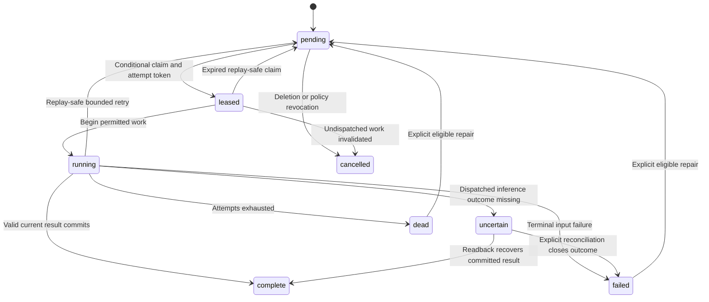
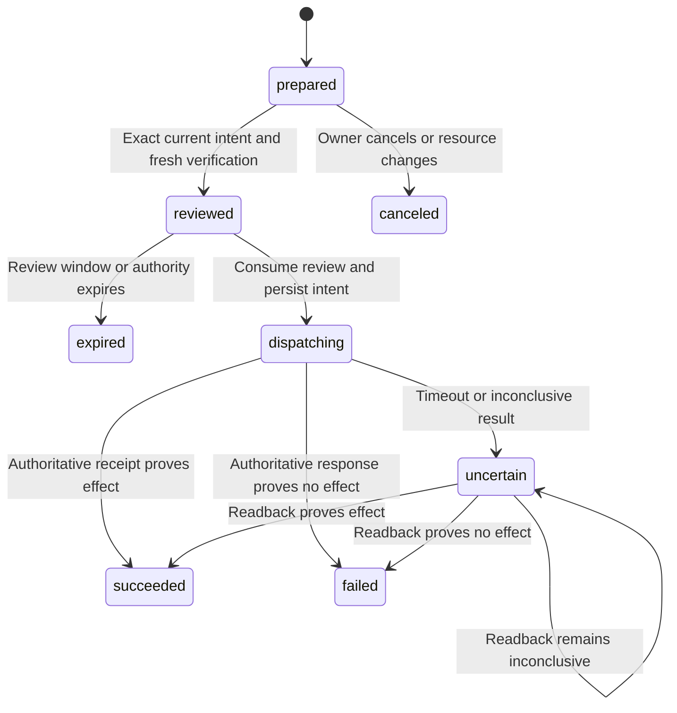

# SDD — Software Design Document

Version 1.0 · October 1, 2026 · **Selected design; not implemented or deployed.**

The [SRS](srs.md) is normative for behavior; the [baseline](baseline.md) owns shared defaults. This document assigns responsibilities and describes collaboration. [LLD](lld.md) specifies storage and public/internal contracts; [TDD](tdd.md) specifies technologies, implementation verification, and operational procedures. [HLD](hld.md) provides the deployment and trust diagrams.

## 1. Subsystems and authoritative ownership

All backend modules ship as one Worker application. They communicate through validated in-process calls and CONTROL_DB jobs/outbox records, not public HTTP calls to themselves. Each mutation has one module responsible for its invariant; a shared CONTROL_DB transaction helper writes the associated change record and mutation receipt. Archive partitions store immutable source/extraction revisions and FTS data; a control registry maps each source to its partition. No transaction spans these databases.

| Subsystem | Owned state and responsibilities | Must not do |
| --- | --- | --- |
| Identity and policy | Owner credentials, devices, sessions, recovery, capability grants, settings versions | Treat an email sender, model answer, or old review as owner authority. |
| Capture and archive | Source receipts, MIME capture states, normalized source revisions, attachment inventory, quarantine, deletion/export | Replace complete text with a summary or claim an object is durable before verification. |
| Processing coordinator | Durable jobs, fenced attempts, outbox dispatch, due-work reconciliation | Retry an uncertain external effect as an internal job. |
| Extraction and retrieval | Extraction status, chunks, text indexes, citations, P3 embedding metadata | Index quarantined/deleted/prohibited content for chat. |
| Attention | Rules/corrections, triage results, concerns, membership, deadlines, review state, briefings | Resolve a concern just because it was opened or send an effect from an AI suggestion. |
| Inference and chat | Route decisions, allowance reservations, task results, conversation/turn state | Override local-only/no-AI policy or accept arbitrary executable model output. |
| Notifications | Eligibility snapshots, delivery identities, registration state, suppression/reconciliation | Mark an item reviewed because a provider accepted a push. |
| Synchronization | Ordered changes, bootstrap boundaries, tombstones, device cursors and mutation receipts | Use timestamps as conflict resolution or advance a cursor without its data. |
| Operations and connectors | Service catalog, report observations, connector grants, external intent/review/receipt | Claim historical reports are live state or reuse a consumed review. |
| Diagnostics and cost | Content-free telemetry, alerts, usage/reservation ledger, health summaries | Include message bodies, attachment bytes, credentials, or excluded support content. |

Android modules mirror user capabilities without duplicating backend authority: Compose renders ViewModel state; repositories expose Room-backed flows; a sync repository submits pending mutations; inference and extraction workers claim specific tasks; device registration manages FCM token changes. DataStore stores preferences appropriate to the device, while server-owned settings are synchronized records. Keystore protects session material; model files and attachment caches follow their own lifecycle.

## 2. Identity, sessions, and policy

Provisioning creates the single owner through a short-lived single-use bootstrap secret delivered by an offline operator CLI. Enrollment registers an owner passkey through Credential Manager and records the device. The bootstrap secret is consumed atomically and cannot become a standing login method. The selected WebAuthn verification implementation must validate the configured RP ID, allowed Android/web origins, challenge, signature, and required user verification; configuration values are established during deployment.

An offline 256-bit recovery key provides independent recovery. The backend stores a one-way verifier; recovery consumes the key, revokes sessions, permits new passkey enrollment, and issues a replacement recovery key that the owner saves outside the phone. Email delivery is not the recovery authority. Passkeys and devices are separately revocable; refresh rotation detects reuse and invalidates the affected session family. Session and review durations come from the baseline.

The policy evaluator is shared by API reads, retrieval, job claims, inference dispatch, notification construction, and connector dispatch. It applies the baseline precedence to the latest policy revision, including immediately before an expensive or consequential step. A task admitted under an older setting does not inherit unlimited authority. Revocation and deletion cancel undispatched work; already dispatched external operations remain visible with their actual known or uncertain outcome. A disaster restore is distinct from normal passkey recovery: restored authentication material is discarded and independent operator verification establishes fresh enrollment before access resumes.

## 3. Capture, quarantine, archive, and deletion

### Capture responsibilities

Manual blocking evaluates normalized envelope addresses and domain rules before raw archival. Sender/domain entries represent explicit owner intent; automatically detected spam goes to quarantine. A sender allow/trust hint cannot override a block. Only content-free block counts persist.

For accepted mail, the capture module creates an immutable staging identity and stores raw MIME bytes. The CONTROL_DB receipt tracks `staged`, `pending_index`, `ready`, `parse_failed`, `deleting` or `deleted`, distinct from quarantine and inference status. The Queue message carries only job identity. A parser restart reads the same staged object, verifies the capture identity, and writes immutable content objects and an archive-partition source revision before publishing the verified source pointer in CONTROL_DB. An archive revision without a ready pointer remains a recoverable partial capture, not a visible complete message. Byte hashes establish integrity, not trust in the sender. Message-ID alone is insufficient for delivery deduplication: repeated delivery must match the source fingerprint specified in the LLD, while a different payload under the same Message-ID remains evidence.

The normalizer keeps all substantive decoded text, including meaningful differences between plain/HTML alternatives, link targets, lists, and table relationships. A shorter display representation and chunking are derived. Inline attachments are retained. Full HTML presentation is not the archival contract. Parsing failure cannot be marked as a successful text archive; the failed receipt remains discoverable with raw recovery material.

### Quarantine behavior

Automatic spam detection begins with provider metadata and bounded deterministic content heuristics. It is a non-generative decision before OCR, generative classification, or embeddings. Suspected mail retains normalized text and original attachments under quarantine. Its metadata is visible in a separate queue; it is excluded from the actionable inbox, ordinary chat, automatic critical decisions, and the default search scope. Explicit quarantine inspection/search does not trigger AI processing.

Release is an idempotent owner mutation that removes quarantine and schedules the same downstream pipeline as ordinary mail. “Not spam” can additionally offer a sender rule, but does not secretly create one. Deletion is a separate reviewed action. A subsequent sender block affects future deliveries; it does not retroactively destroy retained evidence.

### Delete and export

Before the control deletion commits, append a content-free suppression record to the independent private R2 ledger and conditionally advance its signed hash-chain head. A failed ledger write keeps deletion pending; conflicting head updates retry against the current head. The subsequent control transaction hides selected records from server/online reads, records tombstones and the deletion ledger entry, invalidates current citation access, and schedules cleanup for original and derived objects. Ledger entries left without a control commit conservatively suppress the selected source during reconciliation; they cannot resurrect content. Related concerns retain a non-content indication that evidence was deleted; they cannot continue presenting deleted quoted text through an old summary. Export jobs recheck deletion/privacy state before producing output and invalidation prevents download of a stale export containing newly deleted data. Backup restore verifies the current independent ledger head and chain/checkpoint, rather than trusting the older copy in a backup, then reapplies it before serving reads or restarting derivation. Unavailable current suppression evidence blocks restored archive access. Restore also discards every restored passkey, session, recovery hash and FCM registration and requires fresh operator-verified enrollment; an old snapshot cannot revive revoked credentials. An offline phone purges affected cache content when it learns the deletion or revocation on synchronization/rebootstrap; immediate remote erasure of disconnected storage is not promised.

Exports include normalized records, original attachments, relationships, timestamps, provenance and a SHA-256 manifest. Credentials, push tokens, raw recovery verifiers, and provider secrets are excluded. Export status exposes failure versus completion and requires authenticated object download. Retention and cleanup intervals follow the baseline.

## 4. Jobs, durable handoff, and concurrency

The coordinator claims due work with a conditional D1 update and a fresh fenced attempt token. Workers/device clients must provide that token when heartbeating or completing; only the current lease can commit. Results carry input revision and policy revision so changed/deleted inputs are rejected or rescheduled instead of overwriting current output. Exhaustion produces an actionable diagnostics item; it does not loop indefinitely.

The CONTROL_DB source registry pointer, downstream jobs, outbox records, and server sync changes are created in one transaction after the corresponding immutable archive revision is verified. Archive-partition writes happen separately and are reconciled by source identity, revision and hash; search results also require the current control visibility check. A publisher sends an outbox identity to Queues and then records dispatch. A crash between sending and recording creates a possible duplicate, handled by conditional claim and durable job status. The scheduled reconciler repairs overdue dispatches, expired leases, due reminders, unverified capture receipts, and orphan object inventories. It checks stage state before retrying; an R2 object is not deleted merely because a D1 operation temporarily failed.

Local tasks use the same lease protocol. Device work can finish after a lease expires, but its stale result is not accepted automatically; it is discarded or resubmitted as a new eligible attempt. The cloud fallback is selected only when policy allows and no valid local lease owns the task. Export/extraction stages checkpoint per bounded item so a resumed job need not repeat completed objects. A dispatched cloud inference attempt with a missing result is uncertain and keeps its usage reservation; it does not return to the replay-safe retry edge. Provider calls that create external effects use the separate operation state machine below.

## 5. Extraction, indexing, and inference

### Attachment processing

Canonical extraction states are `stored`, `queued`, `extracting`, `ready`, `unsupported`, `failed` and `deferred`; details such as `encrypted`, `limit` and `device_unavailable` explain the condition without inventing another competing lifecycle. Attachment byte integrity is independent of extraction state.

Worker parsers handle the text/document formats selected in the baseline with bounded decompression, recursion, time and output accounting. Android handles PDF extraction/rendering and image OCR through explicit extraction tasks: API 35+ may use PDF text extraction, while API 31–34 uses page rendering and OCR. This preserves the selected minimum API without assuming newer text APIs exist there. A file over the extraction bound, an encrypted file, unsupported type, malformed archive, or unavailable device receives a visible status and retains its original bytes. File signature and declared media type are checked before selecting a parser. Extractors never execute document macros, active HTML, or embedded scripts, and never follow remote links. A `no_ai` source permits deterministic text parsing but forbids OCR, LLM interpretation and embeddings; `local_only` permits eligible device OCR while prohibiting cloud models.

Extraction outputs store source/attachment revision, extractor/model version, page or character range and content hash. Each chunk has a stable citation locator. A replacement extraction uses an immutable generation derived from job identity and fencing token; its chunks and FTS rows insert in an archive-partition batch. A fenced CONTROL_DB transaction checks current lease, source hash and policy, then publishes `attachment_processing.active_generation` with its state/receipt/change. Readers use only that active generation. Late or uncommitted archive writes remain invisible and are garbage-collected after the LLD window; reconciliation covers the separate publication write; old citations remain resolvable only while their evidence is retained and permitted. Each archive-partition D1 FTS index and Room FTS index covers normalized text and completed extraction chunks. CONTROL_DB keeps source-to-partition routing; search visits at most the baseline partition count per page with continuation rather than unbounded fan-out. Archive rollover thresholds and paid-resource approval behavior are defined in the baseline. With no writable shard, archival remains visibly pending in R2 staging instead of being declared complete. Search supports structured filters independently of AI. P3 embeddings are rebuildable derived records; Vectorize candidates are reauthorized against D1 and current source state before disclosure.

### Routing and model output

The routing result records task class, requested policy, selected route, reason, source revisions, allowance reservation, model manifest and current attempt. Rules can completely resolve routine classification without a model call. Included-only cloud dispatch requires a dedicated account allocation or a shared reservation ledger used by every account AI writer; uncoordinated/stale headroom defers cloud work rather than promising zero incremental paid usage from delayed metrics. Auto routing uses the baseline readiness criteria and cloud caps; local-only work waits for an eligible device and never falls back to cloud. A no-AI source can still be archived, searched, manually reviewed, and handled by deterministic notification rules.

Both adapters return a closed schema for summary, importance, category, concern association proposals, cited evidence, uncertain interpretations, candidate dates and proposed supported actions. Validation rejects malformed output, invented source IDs, out-of-scope targets and unsupported operation types. The model's claims cannot change a source's trust level. AI-only “critical” output surfaces urgent attention without bypassing quiet hours as a trusted critical rule would.

Long source text is deterministically chunked within the route-specific baseline request bounds; the local adapter enforces its token context budget separately from the larger cloud character bound; no chunking policy can truncate the retained archive. A multipart interpretation records coverage and marks a partial result as partial. Failed model output is a failed interpretation stage, not a missing message. Accepted corrections remain explicit rules with version/provenance. P3 learning recommends candidate rule changes; only owner acceptance promotes them to effective policy.

## 6. Attention, briefings, and chat

Concern membership first uses verified report concern keys, then valid thread references and owner-confirmed associations. Service aliases can suggest associations but cannot independently merge concerns. Content similarity can propose a merge, but uncertain associations retain independent concerns until the owner confirms. All source messages remain separately accessible. New evidence can reopen a resolved concern when a deterministic rule/report revision identifies a new actionable event; a duplicate delivery or unchanged report does not reopen it. Manual merge/split decisions are durable and versioned.

Importance, read state, acknowledgment, and `open`/`waiting`/`snoozed`/`resolved` lifecycle are independent. Routine actions include acknowledge, resolve, reopen, snooze, mark waiting, edit due date, open source, and contextual chat. AI-extracted dates preserve original wording, interpreted timezone and uncertainty; ambiguous dates are proposed for confirmation. Undo applies to a known routine mutation by a compensating revision-checked mutation and cannot reverse a completed external effect or completed content deletion.

Meaningful review is an explicit acknowledgment, Done/Reopen/Snooze/Wait action, or Mark briefing reviewed. Merely opening the app or reading a card, background synchronization, receipt of push, and token refresh do not update it. Offline review advances the watermark at server receipt time, as specified in the FRD. A briefing query snapshots new/changed/unresolved/overdue concerns since that review watermark. Generated wording adds citations; a deterministic list remains available without AI. Review watermark updates and backlog computation follow the canonical FRD/LLD semantics to avoid reminders caused by background activity.

Chat has global, concern, source, and service scopes. The retrieval service applies the same policy checks to all scopes and returns bounded chunks with provenance. A durable turn identity is created before inference; reconnecting clients query that identity before requesting more work. Turns expose `pending`, `running`, `complete`, `failed`, `uncertain` or `cancelled` state and retain the route/model used. Answers distinguish direct observation, synthesis, and hypothesis; report time is not substituted for current service health. A citation opens the exact retained source revision when available and shows an explicit deletion/unavailable state otherwise.

## 7. Notifications and offline synchronization

Notification candidates derive from committed material attention signals and settings. A persisted `criticalSignalId` changes only for material critical evidence/escalation; a separate `dueRevision` changes only when the due-date obligation changes. Generic concern edits, read/acknowledgment revisions, report sequence increments and unchanged evidence cannot mint another critical/due delivery identity. The evaluator separates trusted critical events, due-date events, and inactivity backlog reminders. It checks acknowledgment/resolution, snooze behavior, quiet hours/timezone, suppression history, policy revision and current registration before creating a delivery identity. The baseline determines cooldowns and critical bypass rules.

FCM messages contain opaque identifiers and generic text. The app fetches current authorized state before showing detailed content. Lock-screen actions are limited to routine controls/opening the app; a consequential action always opens authenticated review. Provider acceptance, device display when observable, tap/open, and meaningful review are different observations. Denied permission or expired registration appears in diagnostics without creating a false successful-delivery claim.

Synchronization reads a bounded, ordered server change stream. A bootstrap establishes a consistent snapshot boundary; subsequent changes start after that boundary so changes made during bootstrap are not skipped. The phone applies each page and its cursor in the same Room transaction. Server writes commit entity revision and change cursor together. Deletes produce tombstones; a cursor older than retention triggers rebootstrap while preserving pending local mutation intents for reconciliation.

Offline routine changes carry immutable request identity, exact payload and expected base revision. After reconnect the server returns the prior result for a duplicate identical request, conflict for identity reuse with another payload, or revision conflict for stale state. Conflicts preserve the owner's pending intent and show current server state for a deliberate retry; last-write-wins does not silently discard either. Pending external actions are drafts/proposals only and require online current-state review.

## 8. P2 operational reports and domain views

P2 uses new email producers around Whumpo's existing operator reports and release records. No such producer or mobile operator API is assumed to exist today. The producer emits an ordinary human-readable email plus the bounded signed JSON attachment defined in the LLD. Its wrapper contains `schemaVersion`, `payloadBase64url`, `keyId`, and `signature`; the HMAC-SHA256 covers the exact decoded UTF-8 JSON payload bytes. The signed payload contains event/service identity, kind, event time, monotonic per-producer sequence, concern key, classification, summary, facts and approved links. It has a 64 KiB limit. Secrets are separate per producer and rotation uses explicit key IDs.

Recognized report envelopes and mail arriving through dedicated report aliases are barred from every model until bounded schema/signature/privacy validation succeeds. A valid signature from a nonrevoked authorized key establishes report provenance for the assigned service/kind only. Deduplication uses service/event identity. Conflicting repeats or sequence regressions are recorded as diagnostics; late historical observations can enrich a timeline but cannot replace a newer last-reported state. Unknown schema/key, signature mismatch, excessive size, unauthorized service/kind, or forbidden/unknown protected fields leaves the email retained as restricted owner evidence with `restricted_metadata` privacy and quarantine, and creates a report validation issue. Its body and attachments cannot fall back to ordinary triage/chat, OCR or embeddings. Only an admitted sanitized projection may enter its allowed downstream pipeline. Releasing quarantine does not silently remove the protected-content privacy restriction. It cannot become a trusted critical report or authorize a service action. Mail transport authentication and report HMAC verification are separate evidence fields.

| View | Producer content and consumer behavior |
| --- | --- |
| Maintenance/recovery | Bounded counts, stage, observation time and unresolved operation references; group by service/operation family. Preserve failed, unavailable, skipped, unobserved and uncertain distinctions. P2 offers review and runbook links, never Retry against a provider. |
| Release/incident timeline | Release ID, service versions, migration identity, accepted/partial/uncertain outcome and approved evidence links. Correlate incidents by service/time while labeling causation as a hypothesis. |
| Operator decisions | Request ID, category, age, state and approved destination only. The producer excludes customer statements and sensitive attachments; metadata-only source classification prevents accidental inclusion in general chat. No promised operator response API is implied. |
| Usage/cost | Currency/unit, period, observed quantity and source class: invoice, estimate, internal usage or unsettled operation. Never combine unlike classes into a claimed verified bill or silently alter customer limits. |
| Services/dependencies | Owner-edited catalog and aliases are authoritative configuration; signed reports propose versioned updates for review. Edges express known dependencies without inferring live availability. |
| Readiness/reminders | Renewal/connection/revocation/backup verification obligations use explicit due dates and evidence. An old backup receipt never becomes proof of current restorability. |
| Runbooks/memory | Owner reviews proposed incident summaries, supporting sources, confirmed actions and cautions. Approved notes become retrievable evidence; recommended steps still need a fresh operation review. |
| Expected heartbeats | Owner sets expected report source and cadence. Only valid signed reports advance its observed watermark. Missing or stale reports create “not recently observed” attention, not a claim that the service is down. |

Approved evidence links are navigational references to configured origins, not arbitrary URLs for the backend to fetch. The report itself is complete enough to show why a concern exists without granting the phone broad operator credentials. P2 integration changes are future work in Whumpo and must pass that repository's privacy and activation gates.

## 9. P3 connectors and reviewed external effects

### Connector lifecycle and reads

Each connector instance has a typed adapter, authorized service/resource allowlist, secret reference, source privacy policy, polling/usage limits and lifecycle state: disabled, validating, active, degraded or revoked. Activation validates the credential's needed scopes through a read-only capability check, stores the owner-approved grant, then enables only the accepted capabilities. Revocation immediately prevents new dispatches, cancels undispatched work, invalidates pending reviews and retains sanitized receipts for already dispatched work. Secrets stay server-side and are never exported or placed in prompts.

Direct Cloudflare reads cover selected Worker/deployment metadata, DNS record metadata, resource usage and relevant service configuration. Whumpo reads use a new narrow operator facade with explicit allowed fields and a current revision, rather than customer-facing endpoints or database credentials. Read snapshots record provider resource ID, revision/ETag if available, observed time, normalized facts, source type and provenance; historical snapshots do not overwrite the current pointer when an older observation arrives. Poll failures preserve the previous snapshot with a stale marker.

Webhook subscriptions validate provider signatures against their configured secrets, enforce bounded bodies, record provider delivery IDs and normalize only allowed event types. GitHub synchronization uses an installation-scoped GitHub App grant for selected repositories and explicitly requested reads; webhooks trigger queued reconciliation for allowed release/workflow/issue/pull-request metadata. Duplicate and out-of-order events cannot directly set authoritative current state. Initial backfill and periodic reconciliation recover missed events through paginated cursors with explicit limits.

Android notification capture requires both OS notification-listener permission and an in-app allowlist of selected packages; Adminifender itself and sensitive/blocked packages are excluded to prevent loops and unintended collection. Captured data records package, notification identity, post/update/removal time and captured text; removal is a source event, not archive deletion. Permission revocation stops capture. Password-manager, authenticator and finance packages remain excluded unless the owner explicitly enables the separate sensitive-package grant. Contextual one-time/verification/OTP patterns redact associated 4–8 digit tokens as `[redacted]` before upload; this bounded rule does not claim universal secret detection. Captured PendingIntents and actions remain inert; the owner previews the grant and sample fields before activation. No notification action intents are invoked. Share/file intake uses explicit Android share/document selection, records the user's source/privacy selection, verifies content and streams an upload through the authenticated archive path. Neither channel becomes enabled merely by shipping P3 code.

### Effects and uncertainty

Adapters expose typed prepare, dispatch and readback capabilities. Preparation fetches current resource state and produces an immutable operation intent: action type, exact allowlisted target, parameters, resource revision, visible effects, expected cost/category, evidence and adapter version. Review binds the digest of that intent, the current owner session and fresh passkey verification. If any target/parameter/revision changes, preparation and review restart.

The following diagram combines review lifecycle and operation outcome; the LLD stores reviews and operation states separately.

The action engine atomically consumes a valid review and records dispatch intent before network dispatch. A crash after that commit may leave the operation uncertain even if the request never left the process; the system chooses honest uncertainty over a duplicate effect. Provider-supported idempotency keys are used, but do not replace readback or authority validation. There is no automatic edge from uncertain to dispatching. A retry creates a new preparation/review only after an adapter establishes it is safe, or the owner performs documented manual reconciliation. Old intents/receipts remain immutable.

P3 supported effect families are explicit:

- **Outbound replies:** prepare sender identity, all recipients, reply/thread headers, subject, exact body and attachment identities; show that external recipients will receive them. Dispatch through the selected Cloudflare outbound email adapter only after domain/account capability verification. A lost delivery response remains uncertain without authoritative delivery evidence; never resend automatically.
- **Cloudflare operations:** `cloudflare.dns.upsert`/`cloudflare.dns.delete` operate on an exact allowlisted zone/record and expected current digest. `cloudflare.worker.version.activate` targets an exact allowlisted script, existing uploaded version and current deployment digest; it covers activation and rollback without uploading code from the phone. Preparation shows exact before/after values and selected resources. No arbitrary deployment source, broad account mutation or free-form command is accepted.
- **Whumpo operations:** `whumpo.release.apply` and `whumpo.recovery.execute` use immutable release/recovery plan IDs prepared by a new narrow operator API. `whumpo.support.respond` reviews a protected request and exact response body outside model context, then records its delivery/operation receipt. Adminifender preserves Whumpo's own review, protected-content and uncertainty requirements; its review cannot bypass a stricter server-side gate. Unsupported families remain navigation/runbook actions until implemented and accepted.

Outbound send, DNS deletion, rollback and recovery all require the same exact-effect review policy. A runbook or old successful receipt is context for preparation, never transferable authorization.

### Advanced intelligence

Semantic retrieval uses the baseline embedding model and Vectorize as a derived candidate index, with D1 enforcing final visibility. Learned triage trains or scores candidate rules from explicit owner corrections; it shows the affected sample/history and requests acceptance before changing an effective rule. Forecasting estimates deadline backlog, usage trends and potential budget pressure from bounded historical observations, labels assumptions/confidence/coverage and keeps estimates distinct from invoices. Forecasts can create reviewable concerns but cannot purchase capacity, alter infrastructure, or set customer payment state.

## 10. Verification and evolution

The SRS contains the only traceability matrix and detailed acceptance cases. This design requires tests at the module boundaries: transactional job creation; object/database partial failure; duplicate/stale job completion; privacy-policy changes during dispatch; offline cursor/revision conflicts; delayed push; invalid signed reports; out-of-order connector events; and uncertain external effects with no automatic replay. TDD defines the development and deployed verification stages.

Additive schema evolution and versioned adapters preserve stored evidence and pending intent semantics. A connector or model change cannot reinterpret an already-reviewed operation. An architectural change supersedes the relevant [ADR](adr/README.md); changing an accepted requirement also updates SRS and its traceability. The owner's actual device, account limits, available report producers and provider scope entitlements are activation inputs, not unspecified architectural alternatives.
